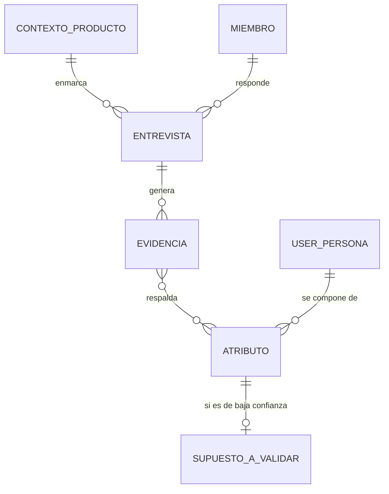
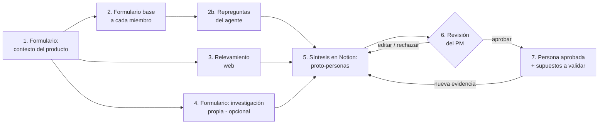

# User-Persona Agente

Agente de IA para construir y usar User Personas basadas en evidencia.

Este repositorio documenta el diseño y la construcción de un agente de IA con **Spec Driven Development (SDD)**. Cada fase produce una especificación que funciona como contrato para la siguiente. No se pasa a una fase sin aprobar la anterior.

## Base metodológica: *Inspired*, de Marty Cagan

Toda la solución se apoya en el enfoque de **product discovery** que Marty Cagan describe en *Inspired: How to Create Tech Products Customers Love*. Estas son las ideas del libro que guían las decisiones de este proyecto:

| Idea de *Inspired* | Cómo se refleja en la solución |
|--------------------|--------------------------------|
| Las personas son útiles solo si nacen de **investigación con usuarios reales**. Una persona inventada formaliza supuestos. | Cada atributo se vincula a su evidencia, y los supuestos del equipo se marcan como tales, con confianza baja. |
| Discovery busca reducir los **cuatro riesgos**: valor, usabilidad, factibilidad y viabilidad de negocio. | Las personas atacan sobre todo los riesgos de **valor** y **usabilidad**: para quién es y qué problema le resuelve. |
| Los equipos de producto se miden por **resultados (outcomes)**, no por lo que entregan (output). | Las personas sirven para definir para quién es cada iniciativa y qué cambio se espera. Ver la visión a largo plazo. |
| Las ideas se **validan con usuarios** antes de construir. | Cada supuesto de baja confianza tiene un plan de validación con usuarios reales. |
| El equipo necesita **contacto frecuente con usuarios**. | El agente no reemplaza ese contacto: lo dispara, proponiendo a quién y qué preguntar. |

> Las ideas de la tabla son una síntesis propia del enfoque del libro, no citas textuales.

## Estado del proceso

| # | Fase | Estado |
|---|------|--------|
| 1 | [Definición del problema](#fase-1-definición-del-problema) | ✅ Aprobada |
| 2 | [Visión del producto](#fase-2-visión-del-producto) | 🟡 En revisión |
| 3 | Requisitos (historias, criterios de aceptación, RNF) | ⚪ Pendiente |
| 4 | Especificación del agente (rol, capacidades, herramientas, límites) | ⚪ Pendiente |
| 5 | Diseño técnico (arquitectura, modelo, prompts, memoria, evals) | ⚪ Pendiente |
| 6 | Plan de tareas | ⚪ Pendiente |
| 7 | Implementación y validación | ⚪ Pendiente |

---

## Fase 1: Definición del problema

### Enunciado

Los equipos de producto toman decisiones de discovery y delivery sin un entendimiento compartido y basado en evidencia de quiénes son sus usuarios, qué necesitan y cómo cada funcionalidad afecta su comportamiento. Por eso construyen funcionalidades que no generan valor, priorizan por intuición o por quien habla más fuerte, y no pueden explicar el impacto de lo que entregan.

### Contexto

Los equipos (PM, diseño e ingeniería) trabajan con un backlog de funcionalidades, pero el conocimiento del usuario está fragmentado. Queda en la cabeza de algunas personas, en investigaciones aisladas o en supuestos que nadie validó.

### Ámbito

- Proyecto personal, independiente de cualquier organización.
- **Agnóstico de producto:** la solución tiene que adaptarse a cualquier producto y a cualquier equipo de producto.

### Situación actual

En el caso general, el equipo **no cuenta con investigación previa**: no hay entrevistas, encuestas ni personas documentadas. Lo que sí suele existir es lo siguiente:

| Fuente de información | Disponibilidad |
|-----------------------|----------------|
| Conocimiento tácito del equipo de producto (lo que creen saber del usuario) | Siempre |
| Contexto del producto: propuesta de valor, funcionalidades, mercado, modelo de negocio | Siempre |
| Información pública: competidores, reseñas, foros, estudios de mercado | Casi siempre, se puede relevar de internet |
| Investigación propia: entrevistas, encuestas, analítica, tickets de soporte | Solo en algunos equipos |

La solución tiene que funcionar con las tres primeras fuentes y aprovechar la cuarta cuando exista. Por ejemplo, el equipo puede cargarla mediante formularios.

### Por qué automatización e IA

Definir personas bien hecho requiere tiempo, criterio metodológico y capacidad de sintetizar mucha información dispersa. La mayoría de los equipos no lo hace por falta de tiempo o de práctica. Una solución con IA puede hacer cuatro cosas:

- **Guiar** al equipo con las preguntas correctas, aunque no tenga experiencia en research.
- **Relevar y sintetizar** información pública y propia mucho más rápido que una persona.
- **Detectar** contradicciones y supuestos no validados en lo que dice el equipo.
- **Proponer** borradores de personas que el equipo revisa, en lugar de partir de una hoja en blanco.

### Restricción fundamental: humano en el circuito

La IA **propone** y las personas **deciden**. Ninguna User Persona se considera válida hasta que la revisa y aprueba un responsable humano, por ejemplo el Product Manager.

### Quién se ve afectado

- **Equipos de producto:** discuten opiniones en lugar de evidencia y les cuesta alinear prioridades.
- **Usuarios finales:** reciben funcionalidades que no resuelven sus problemas reales.
- **Negocio:** invierte capacidad de desarrollo en iniciativas de bajo impacto.

### Síntomas observables

> ⚠️ Son síntomas genéricos. Hay que reemplazarlos o complementarlos con ejemplos reales de la organización.

- Las historias dicen "como usuario…" sin especificar qué tipo de usuario.
- Cada miembro del equipo describe al usuario de forma distinta.
- Las funcionalidades se lanzan sin una hipótesis de impacto ni una métrica asociada.
- Las funcionalidades recién lanzadas tienen baja adopción.
- El equipo no tiene contacto directo y frecuente con usuarios.

### Causas raíz probables

1. No hay una práctica sistemática de discovery con usuarios reales.
2. Lo que se aprende de los usuarios no se documenta ni se comparte de forma accionable.
3. Las funcionalidades se definen como *output* y no como *outcome* para un segmento concreto.
4. No hay un lenguaje común para hablar de los distintos tipos de usuario.

### Impacto

- Se desperdicia capacidad de desarrollo.
- El *time-to-value* es más lento.
- Se ponen en riesgo el **valor** y la **usabilidad**, dos de los cuatro riesgos de producto de Marty Cagan.
- Los equipos se desmotivan cuando lo que construyen no se usa.

### Hipótesis de solución

> Creemos que si los equipos construyen y usan **User Personas basadas en investigación con usuarios reales**, lograremos un entendimiento compartido del usuario que mejore la priorización y el diseño de funcionalidades. Sabremos que funcionó cuando **[métricas por definir]**.
>
> Y creemos que una **solución con IA que guíe al equipo, releve información y proponga personas trazables a su evidencia, con aprobación humana**, baja lo suficiente el costo de hacerlo como para que cualquier equipo lo adopte.

### Posibles métricas de éxito

| Métrica | Línea base | Objetivo |
|---------|-----------|----------|
| % de iniciativas con una persona objetivo y una hipótesis de impacto explícitas | ? | ? |
| Adopción o uso de las funcionalidades lanzadas, comparado con la línea base | ? | ? |
| Cantidad de entrevistas o contactos con usuarios por equipo por mes | ? | ? |
| Alineación del equipo: consistencia de respuestas a "¿para quién es esto y qué problema le resuelve?" | ? | ? |

### Riesgo principal

Cagan advierte que una persona inventada en un workshop, sin datos detrás, es contraproducente porque solo formaliza los supuestos. La persona tiene que nacer de la investigación, y hay que actualizarla y usarla en las decisiones del día a día. Si no, termina como un póster en la pared.

**Implicancia para la solución:** el riesgo es aún mayor con una IA, porque puede generar personas verosímiles sin ninguna evidencia detrás. Como en el caso general las fuentes son el conocimiento del equipo e información pública, el resultado inicial va a ser una **proto-persona**, es decir, una hipótesis y no una verdad. Por eso:

1. Cada atributo de la persona indica su **fuente** y su **nivel de confianza**: dato de investigación propia, dato público o supuesto del equipo.
2. La solución no oculta los supuestos. Los expone y propone **cómo validarlos**, por ejemplo con guías de entrevista o encuestas.
3. La persona es un **artefacto vivo**: madura a medida que entra evidencia nueva.

### Preguntas abiertas de la Fase 1

- [x] ~~**Ámbito**~~: proyecto personal y agnóstico de producto.
- [x] ~~**Situación actual**~~: en general no hay investigación previa; ver las fuentes de información disponibles.
- [x] ~~**Por qué IA**~~: guiar, relevar, sintetizar, detectar supuestos y proponer borradores, siempre con aprobación humana.
- [x] ~~**Métricas**~~: definidas en la Fase 2.
- [ ] **Restricciones técnicas** (presupuesto, stack, plazos): se definen en la Fase 3 como requisitos no funcionales.

---

## Fase 2: Visión del producto

### Objetivo del proyecto

Proyecto de **aprendizaje y portfolio**. Busca demostrar Spec Driven Development y el diseño de agentes de IA con un **MVP funcional y bien documentado**, pensado para un **público limitado**. No hace falta escala, multi-tenant ni monetización.

### Forma de la solución: Notion + agente de IA

En lugar de construir una aplicación propia, la solución usa **Notion como interfaz y como base de conocimiento**, y un **agente de IA** que lee y escribe en Notion.

| Necesidad | Se resuelve con |
|-----------|-----------------|
| Cargar el contexto del producto y la investigación propia | **Formularios de Notion** |
| Entrevistar a cada miembro del equipo | Formulario base de Notion + **repreguntas del agente** en la página de cada miembro |
| Guardar fuentes y evidencia | **Base de datos** de Notion |
| Detallar las User Personas con trazabilidad | **Bases de datos relacionadas**: cada atributo se vincula a su evidencia |
| Revisar y aprobar | **Estado** de la persona, que solo cambia el PM, y comentarios de Notion |
| Versionar | Historial de páginas de Notion |

**Por qué Notion:**
- El público es limitado. No hace falta construir login, invitaciones, pantallas ni permisos: Notion ya los tiene.
- Todo queda en un solo lugar: la información, los formularios y las personas.
- El esfuerzo se concentra en lo que importa demostrar, que es **el agente y la spec**.

**Decisión sobre el agente:** un **agente propio construido con Claude**, que lee y escribe en Notion mediante **MCP**. Notion también tiene agentes nativos y se podría hacer sin código, pero un agente propio da control sobre los prompts, la trazabilidad y las evaluaciones, y tiene más valor para un portfolio. El detalle de la conexión se define en la Fase 5.

### Declaración de visión

> **Para** equipos de producto (PM, diseño e ingeniería) **que** necesitan saber para quién construyen, pero no tienen el tiempo ni la práctica para hacer research,
> **User-Persona Agente** es un **agente de IA que trabaja dentro de Notion**: recopila el conocimiento del equipo mediante formularios y repreguntas, releva información pública, suma la investigación propia y **detalla User Personas trazables a su evidencia**.
> **A diferencia de** los generadores de personas con IA, que inventan perfiles verosímiles en segundos, y de los workshops tradicionales, que formalizan supuestos, **nuestro producto** muestra de dónde sale cada atributo y qué tan confiable es, expone los desacuerdos del equipo, propone cómo validar los supuestos y **no da nada por válido sin la aprobación del Product Manager**.

**Visión a largo plazo:** que las personas sean el lenguaje común del equipo y estén conectadas a las decisiones del día a día. Por ejemplo, integrar Jira para vincular personas a épicas e historias.

### Usuarios y roles

| Rol | Qué hace |
|-----|----------|
| **Product Manager (owner)** | Duplica el espacio de Notion, completa el contexto del producto, invita al equipo, ejecuta el agente, revisa, edita y **aprueba o rechaza** las personas. |
| **Miembro del equipo** (diseño, ingeniería, negocio) | Completa el formulario base y responde las repreguntas del agente en su página. |
| **Aportante de evidencia** (opcional; puede ser el PM) | Carga investigación propia mediante un formulario: entrevistas, encuestas, analítica o tickets de soporte. |

### Estructura en Notion (alto nivel)

| Base de datos | Contenido |
|---------------|-----------|
| **Contexto del producto** | Propuesta de valor, mercado, competidores y modelo de negocio. Se carga por formulario. |
| **Equipo** | Miembros y roles. |
| **Entrevistas** | Respuestas al formulario base y repreguntas del agente, una página por miembro. |
| **Evidencia** | Cada fuente con su tipo (supuesto del equipo, información pública o investigación propia), su origen (miembro o URL) y un extracto. |
| **User Personas** | Una página por persona, con estado (`Borrador → En revisión → Aprobada / Rechazada`), versión y aprobador. |
| **Atributos** | Afirmaciones de la persona por categoría (objetivos, problemas, comportamientos, contexto), con nivel de confianza, evidencias relacionadas y marca de divergencia. |
| **Supuestos a validar** | Plan de validación de cada atributo de baja confianza: método, preguntas sugeridas y estado. |

> El modelo de datos detallado se define en la Fase 5.

### Flujo principal

1. **Contexto del producto:** el PM completa un formulario de Notion.
2. **Entrevista a cada miembro:** cada uno completa por separado un formulario base agnóstico de producto. Después, el agente analiza las respuestas y escribe **repreguntas** en la página de cada miembro para profundizar, aclarar o pedir ejemplos.
3. **Relevamiento web:** el agente busca competidores, reseñas, foros y estudios públicos, y registra cada fuente en la base de evidencia.
4. **Investigación propia** (opcional): se carga mediante un formulario.
5. **Síntesis:** el agente crea o actualiza las páginas de User Persona y sus atributos, cada uno vinculado a su evidencia, con nivel de confianza y marca de divergencia entre miembros.
6. **Revisión humana:** el PM edita, comenta, rechaza o aprueba. **El agente nunca puede marcar una persona como Aprobada.**
7. **Supuestos a validar:** para cada atributo de baja confianza, el agente propone cómo validarlo. Cuando entra evidencia nueva, la persona vuelve a revisión con una nueva versión.

### Principios de producto

1. **Evidencia por sobre verosimilitud:** una persona incompleta y honesta vale más que una completa e inventada.
2. **La IA propone y el humano decide:** toda persona necesita la aprobación explícita del PM.
3. **Supuestos a la vista:** cada atributo muestra su fuente (investigación propia, información pública o supuesto del equipo) y su nivel de confianza.
4. **El desacuerdo es información:** las divergencias del equipo se muestran, no se promedian.
5. **Agnóstico de producto:** ni los formularios, ni las preguntas, ni las plantillas asumen una industria o un tipo de producto.
6. **Accionable, no decorativa:** la persona prioriza objetivos, problemas, comportamientos y contexto de uso por sobre datos de color ("le gusta el café").
7. **Artefacto vivo:** la persona tiene versiones y madura con la evidencia.
8. **Donde el equipo ya trabaja:** todo pasa en Notion, sin herramientas nuevas que adoptar.

### Qué es y qué no es

| ✅ Es | ❌ No es |
|-------|---------|
| Un agente de discovery que estructura y acelera la definición de personas dentro de Notion | Un generador de personas en un clic |
| Una herramienta que hace explícitos los supuestos y propone cómo validarlos | Un reemplazo de hablar con usuarios reales |
| Un espacio donde el equipo se alinea sobre quién es el usuario | Una herramienta de analítica ni un CRM |
| Un MVP de portfolio para un público limitado | Una aplicación web propia ni un SaaS |

### Alcance

| MVP | Futuro (fuera del MVP) |
|-----|------------------------|
| Plantilla de Notion con bases de datos y formularios | Integración con Jira: personas vinculadas a épicas e historias y marca de historias "como usuario…" sin persona |
| Formulario de contexto del producto | Ingesta automática (transcripciones, analítica, tickets) |
| Formulario base para cada miembro del equipo + repreguntas del agente | Ejecución automática del agente ante cada formulario nuevo |
| Relevamiento web con fuentes citadas | Alertas de personas desactualizadas |
| Formulario de investigación propia | Uso por muchos equipos en paralelo |
| Síntesis de proto-personas con fuente, confianza y divergencias | |
| Revisión y aprobación por el PM mediante estados de Notion | |
| Supuestos a validar con métodos sugeridos | |

### Métricas de éxito del producto

Las métricas de impacto de la Fase 1, como la adopción de funcionalidades o el % de iniciativas con persona objetivo, se miden a largo plazo y quedan fuera del alcance de un MVP de portfolio. Para el MVP medimos la **calidad y la utilidad de la solución**:

| Métrica | Tipo | Objetivo MVP |
|---------|------|--------------|
| **Trazabilidad:** % de atributos de cada persona vinculados a al menos una evidencia | Guardrail | **100%** |
| **Aprobación indebida:** personas que el agente marca como Aprobada | Guardrail | **0** |
| **Aceptación:** % de personas propuestas que **el PM aprueba**, con o sin ediciones menores | Calidad | ≥ 70% |
| **Retrabajo:** % de atributos que el PM tiene que reescribir | Calidad | ≤ 30% |
| **Esfuerzo por miembro:** formulario base + repreguntas | Eficiencia | ≤ 30 min (pauta de diseño: ≤ 15 preguntas base y ≤ 5 repreguntas) |
| **Tiempo total:** desde el contexto cargado hasta la primera persona aprobada | Eficiencia | ≤ 1 día de calendario |
| **Accionabilidad:** % de supuestos de baja confianza con un plan de validación | Accionabilidad | 100% |
| **Alineación:** divergencias del equipo detectadas y mostradas | Alineación | Se detectan todas las divergencias planteadas a propósito en la prueba |

**Qué significa trazabilidad.** Un *atributo* es cada afirmación de la persona, por ejemplo "Concilia los pagos a mano en Excel una vez por semana". Para que cuente como trazable, tiene que estar vinculado al menos a una fila de la base de **Evidencia** que diga de dónde salió: la respuesta de un miembro del equipo, una fuente pública con su URL o una investigación propia. Si solo lo dijo el equipo, igual queda vinculado, pero como **supuesto del equipo** y con confianza baja. Lo que no puede existir es un atributo sin ninguna evidencia, porque eso sería algo que el agente inventó.

### Plan de prueba del MVP

**Producto de prueba: cobros-recurrentes.** Es una app para que un **emisor** (un particular, una sociedad de fomento o un profesional independiente, en Argentina) le cobre un monto recurrente a un **pagador**. El pago se pide por email o WhatsApp, sin login, y la conciliación del comprobante es manual. Es un buen caso de prueba por tres razones:

- Es un producto real, con una spec escrita pero **sin investigación con usuarios**: el caso general que plantea la Fase 1.
- Tiene dos actores muy distintos y, dentro del emisor, **segmentos que pueden tener necesidades diferentes**. Son candidatos naturales a varias personas.
- Su spec sirve como insumo para el **formulario de contexto del producto**: el agente no lee el repositorio, lee lo que el PM carga en Notion.

**Miembros del equipo: una persona con distintos sombreros.** Abel completa los formularios y responde las repreguntas varias veces, cada vez con un rol distinto, por ejemplo PM, diseño, ingeniería y negocio. Cada rol tiene su propio nivel de conocimiento del usuario y sus opiniones. En algunos puntos se plantean **divergencias a propósito** para verificar que el agente las detecte. Como responde una persona real, el esfuerzo por miembro **se mide en minutos**.

### Preguntas abiertas de la Fase 2

- [x] ~~**Objetivo del proyecto**~~: aprendizaje y portfolio, con un público limitado.
- [x] ~~**Forma**~~: Notion (formularios + bases de datos) con un agente de IA. Jira queda para el futuro.
- [x] ~~**Entrevistas**~~: a cada miembro del equipo por separado, con formulario base y repreguntas del agente.
- [x] ~~**Agente**~~: propio con Claude, conectado a Notion por MCP.
- [x] ~~**Métricas**~~: aprobadas.
- [x] ~~**Producto de prueba**~~: **cobros-recurrentes**. Abel hace de los distintos miembros del equipo.
- [x] ~~**Base metodológica**~~: *Inspired*, de Marty Cagan.
