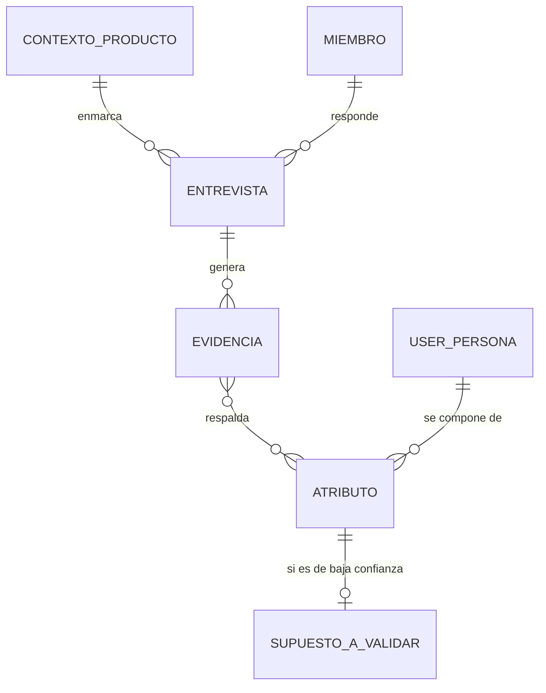
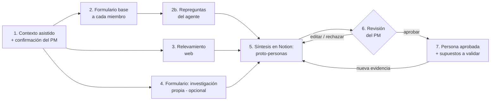
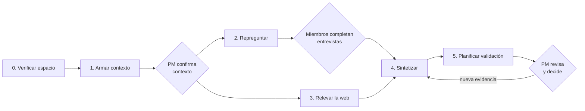
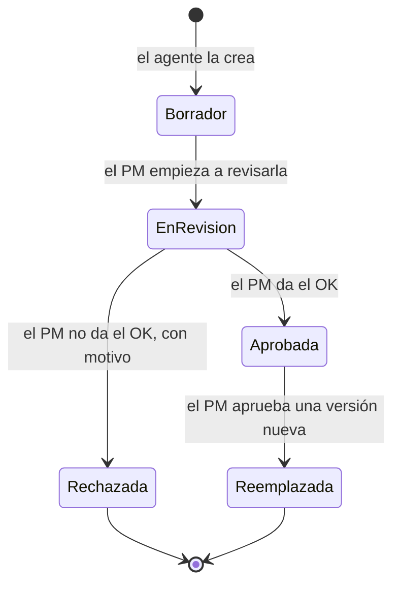
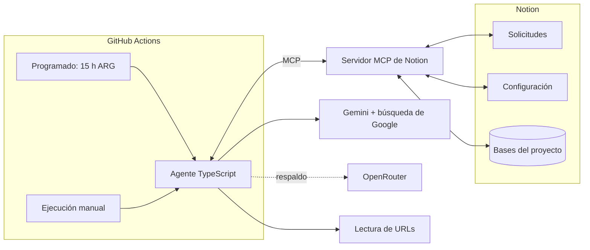
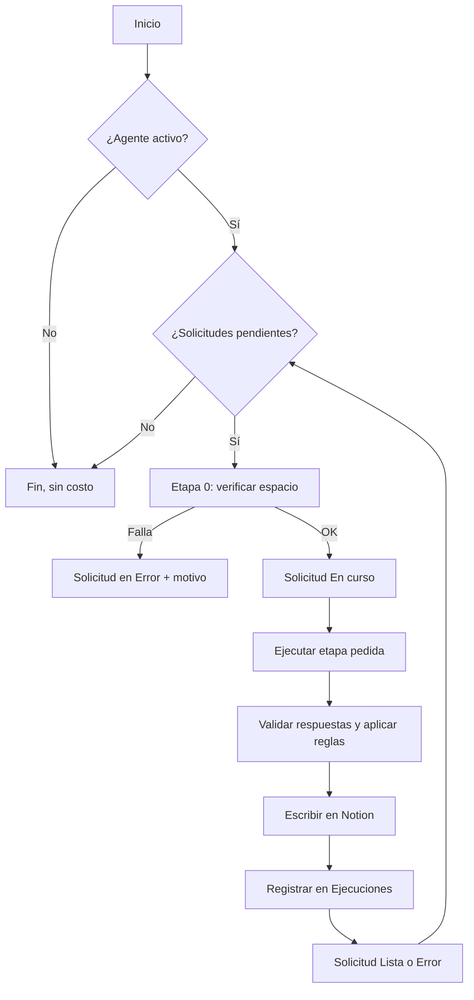
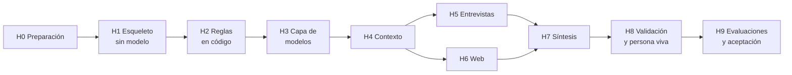

# User-Persona Agente

Agente de IA para construir y usar User Personas basadas en evidencia.

Este repositorio documenta el diseño y la construcción de un agente de IA con **Spec Driven Development (SDD)**. Cada fase produce una especificación que funciona como contrato para la siguiente. No se pasa a una fase sin aprobar la anterior.

> 🔁 **¿Retomás el trabajo en otro chat?** Empezá por el [Caso de estudio: bitácora del proyecto](#caso-de-estudio-bitácora-del-proyecto).

## Base metodológica: *Inspired*, de Marty Cagan

Toda la solución se apoya en el enfoque de **product discovery** que Marty Cagan describe en *Inspired: How to Create Tech Products Customers Love*. Estas son las ideas del libro que guían las decisiones de este proyecto:

| Idea de *Inspired* | Cómo se refleja en la solución |
|--------------------|--------------------------------|
| Las personas son útiles solo si nacen de **investigación con usuarios reales**. Una persona inventada formaliza supuestos. | Cada atributo se vincula a su evidencia, y los supuestos del equipo se marcan como tales, con confianza baja. |
| Discovery busca reducir los **cuatro riesgos**: valor, usabilidad, factibilidad y viabilidad de negocio. | Las personas atacan sobre todo los riesgos de **valor** y **usabilidad**: para quién es y qué problema le resuelve. |
| Los equipos de producto se miden por **resultados (outcomes)**, no por lo que entregan (output). | Las personas sirven para definir para quién es cada iniciativa y qué cambio se espera. Ver la visión a largo plazo. |
| Las ideas se **validan con usuarios** antes de construir. | Cada supuesto de baja confianza tiene un plan de validación con usuarios reales. |
| El equipo necesita **contacto frecuente con usuarios**. | El agente no reemplaza ese contacto: lo dispara, proponiendo a quién y qué preguntar. |

> Las ideas de la tabla son una síntesis propia del enfoque del libro, no citas textuales.

## Estado del proceso

| # | Fase | Estado |
|---|------|--------|
| 1 | [Definición del problema](#fase-1-definición-del-problema) | ✅ Aprobada |
| 2 | [Visión del producto](#fase-2-visión-del-producto) | ✅ Aprobada |
| 3 | [Requisitos](#fase-3-requisitos) (historias, criterios de aceptación, RNF) | ✅ Aprobada |
| 4 | [Especificación del agente](#fase-4-especificación-del-agente) (rol, capacidades, herramientas, límites) | ✅ Aprobada |
| 5 | [Diseño técnico](#fase-5-diseño-técnico) (arquitectura, modelo, prompts, memoria, evals) | ✅ Aprobada |
| 6 | [Plan de tareas](#fase-6-plan-de-tareas) | 🟡 En revisión |
| 7 | Implementación y validación | ⚪ Pendiente |

---

## Fase 1: Definición del problema

### Enunciado

Los equipos de producto toman decisiones de discovery y delivery sin un entendimiento compartido y basado en evidencia de quiénes son sus usuarios, qué necesitan y cómo cada funcionalidad afecta su comportamiento. Por eso construyen funcionalidades que no generan valor, priorizan por intuición o por quien habla más fuerte, y no pueden explicar el impacto de lo que entregan.

### Contexto

Los equipos (PM, diseño e ingeniería) trabajan con un backlog de funcionalidades, pero el conocimiento del usuario está fragmentado. Queda en la cabeza de algunas personas, en investigaciones aisladas o en supuestos que nadie validó.

### Ámbito

- Proyecto personal, independiente de cualquier organización.
- **Agnóstico de producto:** la solución tiene que adaptarse a cualquier producto y a cualquier equipo de producto.

### Situación actual

En el caso general, el equipo **no cuenta con investigación previa**: no hay entrevistas, encuestas ni personas documentadas. Lo que sí suele existir es lo siguiente:

| Fuente de información | Disponibilidad |
|-----------------------|----------------|
| Conocimiento tácito del equipo de producto (lo que creen saber del usuario) | Siempre |
| Contexto del producto: propuesta de valor, funcionalidades, mercado, modelo de negocio | Siempre |
| Información pública: competidores, reseñas, foros, estudios de mercado | Casi siempre, se puede relevar de internet |
| Investigación propia: entrevistas, encuestas, analítica, tickets de soporte | Solo en algunos equipos |

La solución tiene que funcionar con las tres primeras fuentes y aprovechar la cuarta cuando exista. Por ejemplo, el equipo puede cargarla mediante formularios.

### Por qué automatización e IA

Definir personas bien hecho requiere tiempo, criterio metodológico y capacidad de sintetizar mucha información dispersa. La mayoría de los equipos no lo hace por falta de tiempo o de práctica. Una solución con IA puede hacer cuatro cosas:

- **Guiar** al equipo con las preguntas correctas, aunque no tenga experiencia en research.
- **Relevar y sintetizar** información pública y propia mucho más rápido que una persona.
- **Detectar** contradicciones y supuestos no validados en lo que dice el equipo.
- **Proponer** borradores de personas que el equipo revisa, en lugar de partir de una hoja en blanco.

### Restricción fundamental: humano en el circuito

La IA **propone** y las personas **deciden**. Ninguna User Persona se considera válida hasta que la revisa y aprueba un responsable humano, por ejemplo el Product Manager.

### Quién se ve afectado

- **Equipos de producto:** discuten opiniones en lugar de evidencia y les cuesta alinear prioridades.
- **Usuarios finales:** reciben funcionalidades que no resuelven sus problemas reales.
- **Negocio:** invierte capacidad de desarrollo en iniciativas de bajo impacto.

### Síntomas observables

> ⚠️ Son síntomas genéricos. Hay que reemplazarlos o complementarlos con ejemplos reales de la organización.

- Las historias dicen "como usuario…" sin especificar qué tipo de usuario.
- Cada miembro del equipo describe al usuario de forma distinta.
- Las funcionalidades se lanzan sin una hipótesis de impacto ni una métrica asociada.
- Las funcionalidades recién lanzadas tienen baja adopción.
- El equipo no tiene contacto directo y frecuente con usuarios.

### Causas raíz probables

1. No hay una práctica sistemática de discovery con usuarios reales.
2. Lo que se aprende de los usuarios no se documenta ni se comparte de forma accionable.
3. Las funcionalidades se definen como *output* y no como *outcome* para un segmento concreto.
4. No hay un lenguaje común para hablar de los distintos tipos de usuario.

### Impacto

- Se desperdicia capacidad de desarrollo.
- El *time-to-value* es más lento.
- Se ponen en riesgo el **valor** y la **usabilidad**, dos de los cuatro riesgos de producto de Marty Cagan.
- Los equipos se desmotivan cuando lo que construyen no se usa.

### Hipótesis de solución

> Creemos que si los equipos construyen y usan **User Personas basadas en investigación con usuarios reales**, lograremos un entendimiento compartido del usuario que mejore la priorización y el diseño de funcionalidades. Sabremos que funcionó cuando **[métricas por definir]**.
>
> Y creemos que una **solución con IA que guíe al equipo, releve información y proponga personas trazables a su evidencia, con aprobación humana**, baja lo suficiente el costo de hacerlo como para que cualquier equipo lo adopte.

### Posibles métricas de éxito

| Métrica | Línea base | Objetivo |
|---------|-----------|----------|
| % de iniciativas con una persona objetivo y una hipótesis de impacto explícitas | ? | ? |
| Adopción o uso de las funcionalidades lanzadas, comparado con la línea base | ? | ? |
| Cantidad de entrevistas o contactos con usuarios por equipo por mes | ? | ? |
| Alineación del equipo: consistencia de respuestas a "¿para quién es esto y qué problema le resuelve?" | ? | ? |

### Riesgo principal

Cagan advierte que una persona inventada en un workshop, sin datos detrás, es contraproducente porque solo formaliza los supuestos. La persona tiene que nacer de la investigación, y hay que actualizarla y usarla en las decisiones del día a día. Si no, termina como un póster en la pared.

**Implicancia para la solución:** el riesgo es aún mayor con una IA, porque puede generar personas verosímiles sin ninguna evidencia detrás. Como en el caso general las fuentes son el conocimiento del equipo e información pública, el resultado inicial va a ser una **proto-persona**, es decir, una hipótesis y no una verdad. Por eso:

1. Cada atributo de la persona indica su **fuente** y su **nivel de confianza**: dato de investigación propia, dato público o supuesto del equipo.
2. La solución no oculta los supuestos. Los expone y propone **cómo validarlos**, por ejemplo con guías de entrevista o encuestas.
3. La persona es un **artefacto vivo**: madura a medida que entra evidencia nueva.

### Preguntas abiertas de la Fase 1

- [x] ~~**Ámbito**~~: proyecto personal y agnóstico de producto.
- [x] ~~**Situación actual**~~: en general no hay investigación previa; ver las fuentes de información disponibles.
- [x] ~~**Por qué IA**~~: guiar, relevar, sintetizar, detectar supuestos y proponer borradores, siempre con aprobación humana.
- [x] ~~**Métricas**~~: definidas en la Fase 2.
- [x] ~~**Restricciones técnicas**~~: definidas en la Fase 3 como requisitos no funcionales.

---

## Fase 2: Visión del producto

### Objetivo del proyecto

Proyecto de **aprendizaje y portfolio**. Busca demostrar Spec Driven Development y el diseño de agentes de IA con un **MVP funcional y bien documentado**, pensado para un **público limitado**. No hace falta escala, multi-tenant ni monetización.

### Forma de la solución: Notion + agente de IA

En lugar de construir una aplicación propia, la solución usa **Notion como interfaz y como base de conocimiento**, y un **agente de IA** que lee y escribe en Notion.

| Necesidad | Se resuelve con |
|-----------|-----------------|
| Cargar el contexto del producto | **El agente lo extrae** de fuentes que indica el PM (documento o URL), y el PM lo confirma. Hay un formulario como alternativa (ajustado en la Fase 3). |
| Cargar la investigación propia | **Formularios de Notion** |
| Entrevistar a cada miembro del equipo | Formulario base de Notion + **repreguntas del agente** en la página de cada miembro |
| Guardar fuentes y evidencia | **Base de datos** de Notion |
| Detallar las User Personas con trazabilidad | **Bases de datos relacionadas**: cada atributo se vincula a su evidencia |
| Revisar y aprobar | **Estado** de la persona, que solo cambia el PM, y comentarios de Notion |
| Versionar | Historial de páginas de Notion |

**Por qué Notion:**
- El público es limitado. No hace falta construir login, invitaciones, pantallas ni permisos: Notion ya los tiene.
- Todo queda en un solo lugar: la información, los formularios y las personas.
- El esfuerzo se concentra en lo que importa demostrar, que es **el agente y la spec**.

**Decisión sobre el agente:** un **agente propio**, con código y prompts propios, que lee y escribe en Notion mediante **MCP**. Notion también tiene agentes nativos y se podría hacer sin código, pero un agente propio da control sobre los prompts, la trazabilidad y las evaluaciones, y tiene más valor para un portfolio. El detalle de la conexión se define en la Fase 5.

**Modelo de lenguaje** (definido en la Fase 3): la **capa gratuita de Gemini** como proveedor principal y **OpenRouter** como secundario. El agente no depende de un proveedor en particular.

### Declaración de visión

> **Para** equipos de producto (PM, diseño e ingeniería) **que** necesitan saber para quién construyen, pero no tienen el tiempo ni la práctica para hacer research,
> **User-Persona Agente** es un **agente de IA que trabaja dentro de Notion**: recopila el conocimiento del equipo mediante formularios y repreguntas, releva información pública, suma la investigación propia y **detalla User Personas trazables a su evidencia**.
> **A diferencia de** los generadores de personas con IA, que inventan perfiles verosímiles en segundos, y de los workshops tradicionales, que formalizan supuestos, **nuestro producto** muestra de dónde sale cada atributo y qué tan confiable es, expone los desacuerdos del equipo, propone cómo validar los supuestos y **no da nada por válido sin la aprobación del Product Manager**.

**Visión a largo plazo:** que las personas sean el lenguaje común del equipo y estén conectadas a las decisiones del día a día. Por ejemplo, integrar Jira para vincular personas a épicas e historias.

### Usuarios y roles

| Rol | Qué hace |
|-----|----------|
| **Product Manager (owner)** | Duplica el espacio de Notion, indica las fuentes del contexto del producto y lo confirma, invita al equipo, ejecuta el agente, revisa, edita y **aprueba o rechaza** las personas. |
| **Miembro del equipo** (diseño, ingeniería, negocio) | Completa el formulario base y responde las repreguntas del agente en su página. |
| **Aportante de evidencia** (opcional; puede ser el PM) | Carga investigación propia mediante un formulario: entrevistas, encuestas, analítica o tickets de soporte. |

### Estructura en Notion (alto nivel)



| Base de datos | Contenido |
|---------------|-----------|
| **Contexto del producto** | Propuesta de valor, mercado, competidores y modelo de negocio, cada uno con su fuente. Lo arma el agente a partir de las fuentes que indica el PM, y el PM lo confirma. |
| **Equipo** | Miembros y roles. |
| **Entrevistas** | Respuestas al formulario base y repreguntas del agente, una página por miembro. |
| **Evidencia** | Cada fuente con su tipo (supuesto del equipo, información pública o investigación propia), su origen (miembro o URL) y un extracto. |
| **User Personas** | Una página por persona y versión, con estado (`Borrador → En revisión → Aprobada / Rechazada`, y `Reemplazada` para versiones anteriores), versión y aprobador. |
| **Atributos** | Afirmaciones de la persona por categoría (objetivos, problemas, comportamientos, contexto), con nivel de confianza, evidencias relacionadas y marca de divergencia. |
| **Supuestos a validar** | Plan de validación de cada atributo de baja confianza: método, preguntas sugeridas y estado. |

> El modelo de datos detallado se define en la Fase 5.

### Flujo principal



1. **Contexto del producto:** el PM indica las fuentes, el agente arma el contexto y el PM lo confirma. Si no hay nada escrito, se usa un formulario (ajustado en la Fase 3).
2. **Entrevista a cada miembro:** cada uno completa por separado un formulario base agnóstico de producto. Después, el agente analiza las respuestas y escribe **repreguntas** en la página de cada miembro para profundizar, aclarar o pedir ejemplos.
3. **Relevamiento web:** el agente busca competidores, reseñas, foros y estudios públicos, y registra cada fuente en la base de evidencia.
4. **Investigación propia** (opcional): se carga mediante un formulario.
5. **Síntesis:** el agente crea o actualiza las páginas de User Persona y sus atributos, cada uno vinculado a su evidencia, con nivel de confianza y marca de divergencia entre miembros.
6. **Revisión humana:** el PM edita, comenta, rechaza o aprueba. **El agente nunca puede marcar una persona como Aprobada.**
7. **Supuestos a validar:** para cada atributo de baja confianza, el agente propone cómo validarlo. Cuando entra evidencia nueva, el agente crea una versión nueva de la persona para revisar.

### Principios de producto

1. **Evidencia por sobre verosimilitud:** una persona incompleta y honesta vale más que una completa e inventada.
2. **La IA propone y el humano decide:** toda persona necesita la aprobación explícita del PM.
3. **Supuestos a la vista:** cada atributo muestra su fuente (investigación propia, información pública o supuesto del equipo) y su nivel de confianza.
4. **El desacuerdo es información:** las divergencias del equipo se muestran, no se promedian.
5. **Agnóstico de producto:** ni los formularios, ni las preguntas, ni las plantillas asumen una industria o un tipo de producto.
6. **Accionable, no decorativa:** la persona prioriza objetivos, problemas, comportamientos y contexto de uso por sobre datos de color ("le gusta el café").
7. **Artefacto vivo:** la persona tiene versiones y madura con la evidencia.
8. **Donde el equipo ya trabaja:** todo pasa en Notion, sin herramientas nuevas que adoptar.

### Qué es y qué no es

| ✅ Es | ❌ No es |
|-------|---------|
| Un agente de discovery que estructura y acelera la definición de personas dentro de Notion | Un generador de personas en un clic |
| Una herramienta que hace explícitos los supuestos y propone cómo validarlos | Un reemplazo de hablar con usuarios reales |
| Un espacio donde el equipo se alinea sobre quién es el usuario | Una herramienta de analítica ni un CRM |
| Un MVP de portfolio para un público limitado | Una aplicación web propia ni un SaaS |

### Alcance

| MVP | Futuro (fuera del MVP) |
|-----|------------------------|
| Plantilla de Notion con bases de datos y formularios | Integración con Jira: personas vinculadas a épicas e historias y marca de historias "como usuario…" sin persona |
| Contexto asistido desde un documento o una URL, con confirmación del PM | Ingesta automática (transcripciones, analítica, tickets) |
| Formulario base para cada miembro del equipo + repreguntas del agente | Ejecución automática del agente ante cada formulario nuevo |
| Relevamiento web con fuentes citadas | Alertas de personas desactualizadas |
| Formulario de investigación propia | Uso por muchos equipos en paralelo |
| Síntesis de proto-personas con fuente, confianza y divergencias | |
| Revisión y aprobación por el PM mediante estados de Notion | |
| Supuestos a validar con métodos sugeridos | |

### Métricas de éxito del producto

Las métricas de impacto de la Fase 1, como la adopción de funcionalidades o el % de iniciativas con persona objetivo, se miden a largo plazo y quedan fuera del alcance de un MVP de portfolio. Para el MVP medimos la **calidad y la utilidad de la solución**:

| Métrica | Tipo | Objetivo MVP |
|---------|------|--------------|
| **Trazabilidad:** % de atributos de cada persona vinculados a al menos una evidencia | Guardrail | **100%** |
| **Aprobación indebida:** personas que el agente marca como Aprobada | Guardrail | **0** |
| **Aceptación:** % de personas propuestas que **el PM aprueba**, con o sin ediciones menores | Calidad | ≥ 70% |
| **Retrabajo:** % de atributos que el PM tiene que reescribir | Calidad | ≤ 30% |
| **Esfuerzo por miembro:** formulario base + repreguntas | Eficiencia | ≤ 30 min (pauta de diseño: ≤ 15 preguntas base y ≤ 5 repreguntas) |
| **Tiempo total:** desde el contexto cargado hasta la primera persona aprobada | Eficiencia | ≤ 1 día de calendario |
| **Accionabilidad:** % de supuestos de baja confianza con un plan de validación | Accionabilidad | 100% |
| **Alineación:** divergencias del equipo detectadas y mostradas | Alineación | Se detectan todas las divergencias planteadas a propósito en la prueba |

**Qué significa trazabilidad.** Un *atributo* es cada afirmación de la persona, por ejemplo "Concilia los pagos a mano en Excel una vez por semana". Para que cuente como trazable, tiene que estar vinculado al menos a una fila de la base de **Evidencia** que diga de dónde salió: la respuesta de un miembro del equipo, una fuente pública con su URL o una investigación propia. Si solo lo dijo el equipo, igual queda vinculado, pero como **supuesto del equipo** y con confianza baja. Lo que no puede existir es un atributo sin ninguna evidencia, porque eso sería algo que el agente inventó.

### Plan de prueba del MVP

**Producto de prueba: cobros-recurrentes.** Es una app para que un **emisor** (un particular, una sociedad de fomento o un profesional independiente, en Argentina) le cobre un monto recurrente a un **pagador**. El pago se pide por email o WhatsApp, sin login, y la conciliación del comprobante es manual. Es un buen caso de prueba por tres razones:

- Es un producto real, con una spec escrita pero **sin investigación con usuarios**: el caso general que plantea la Fase 1.
- Tiene dos actores muy distintos y, dentro del emisor, **segmentos que pueden tener necesidades diferentes**. Son candidatos naturales a varias personas.
- Su spec es la fuente del **contexto asistido**: se sube a Notion solo la spec, no el código del repositorio.

**Miembros del equipo: una persona con distintos sombreros.** Abel completa los formularios y responde las repreguntas varias veces, cada vez con un rol distinto, por ejemplo PM, diseño, ingeniería y negocio. Cada rol tiene su propio nivel de conocimiento del usuario y sus opiniones. En algunos puntos se plantean **divergencias a propósito** para verificar que el agente las detecte. Como responde una persona real, el esfuerzo por miembro **se mide en minutos**.

### Preguntas abiertas de la Fase 2

- [x] ~~**Objetivo del proyecto**~~: aprendizaje y portfolio, con un público limitado.
- [x] ~~**Forma**~~: Notion (formularios + bases de datos) con un agente de IA. Jira queda para el futuro.
- [x] ~~**Entrevistas**~~: a cada miembro del equipo por separado, con formulario base y repreguntas del agente.
- [x] ~~**Agente**~~: propio, conectado a Notion por MCP. Usa Gemini (capa gratuita) como modelo principal y OpenRouter como secundario.
- [x] ~~**Métricas**~~: aprobadas.
- [x] ~~**Producto de prueba**~~: **cobros-recurrentes**. Abel hace de los distintos miembros del equipo.
- [x] ~~**Base metodológica**~~: *Inspired*, de Marty Cagan.

---

## Fase 3: Requisitos

### Restricciones y requisitos no funcionales (RNF)

| ID | Requisito | Detalle |
|----|-----------|---------|
| RNF-01 | **Costo cero en IA** | Se usa la **capa gratuita de Gemini** como proveedor principal y **modelos gratuitos de OpenRouter** como secundario. |
| RNF-02 | **Independencia del proveedor** | El agente accede a los modelos mediante una capa de abstracción. Cambiar de proveedor o de modelo es configuración, no código. |
| RNF-03 | **Tolerancia a límites de uso** | Las capas gratuitas limitan solicitudes y tokens. Cuando se alcanza un límite, el agente espera y reintenta o pasa al proveedor secundario. Nunca pierde trabajo: cada etapa se puede retomar donde quedó. |
| RNF-04 | **Idempotencia** | Volver a ejecutar una etapa no duplica evidencias, atributos ni personas: actualiza lo que existe. |
| RNF-05 | **Idioma del equipo** | El agente trabaja en el idioma en que se cargó el contexto del producto: repreguntas, personas, evidencia y planes de validación. |
| RNF-06 | **Privacidad** | Según sus términos, las capas gratuitas pueden usar los datos enviados para mejorar los modelos. Por eso **no se cargan datos personales** de usuarios finales: la investigación propia se carga anonimizada y los formularios lo advierten. |
| RNF-07 | **Aprobación protegida por código** | La regla "el agente nunca marca una persona como Aprobada" se controla **en el código**, antes de cada escritura en Notion, y no solo en el prompt. |
| RNF-08 | **Auditoría** | Cada ejecución queda registrada en Notion: etapa, fecha, proveedor y modelo, qué leyó, qué escribió y qué errores hubo. |
| RNF-09 | **Ejecución a demanda** | En el MVP, el PM pide cada etapa desde Notion y el agente la atiende en su próxima ejecución programada (ajustado en la Fase 5). La ejecución automática ante cada formulario nuevo queda para el futuro. |
| RNF-10 | **Mínimo acceso** | El agente solo accede a las páginas de Notion que se comparten explícitamente con su integración. |
| RNF-11 | **Fuentes verificables** | Toda evidencia pública tiene URL, título, fecha de consulta y extracto. |
| RNF-12 | **Agnóstico de producto** | Ni los formularios, ni los prompts, ni las plantillas mencionan una industria o un producto concreto. |
| RNF-13 | **Plazo** | Sin plazo fijo: se avanza fase por fase. |

### Regla de nivel de confianza

Un atributo toma el nivel de su **mejor evidencia**:

| Nivel | Cuándo |
|-------|--------|
| 🟢 **Alta** | Lo respalda investigación propia con usuarios reales, de al menos dos fuentes independientes. |
| 🟡 **Media** | Lo respalda una sola investigación propia, o información pública que coincide con lo que dice el equipo. |
| 🔴 **Baja** | Solo lo respaldan supuestos del equipo, o información pública que el equipo no confirma. |

Un atributo con **divergencia** sin resolver nunca puede tener confianza alta.

### Épicas e historias de usuario

Prioridad según MoSCoW: **M** = must, **S** = should, **C** = could.

#### E1. Espacio de trabajo

**HU-01 · Plantilla de Notion (M).** Como PM, quiero duplicar una plantilla de Notion con las bases y los formularios listos, para empezar sin configurar nada.
- **Dado** que duplico la plantilla, **entonces** existen las bases Contexto del producto, Equipo, Entrevistas, Evidencia, User Personas, Atributos, Supuestos a validar, Ejecuciones y Solicitudes, la página Configuración (ajustado en la Fase 5), con sus relaciones, la página de fuentes del contexto y los formularios de entrevista base, de investigación propia y de contexto manual.
- **Dado** que ejecuto el agente, **cuando** falta alguna base o propiedad obligatoria, **entonces** el agente no avanza y lista lo que falta.

**HU-02 · Conexión segura (M).** Como PM, quiero conectar el agente solo a mi espacio del proyecto, para controlar qué puede leer y escribir.
- **Dado** que compartí el espacio con la integración, **entonces** el agente opera solo sobre esas páginas.

#### E2. Contexto del producto

**HU-03 · Contexto asistido (M).** Como PM, quiero indicarle al agente de dónde sacar el contexto del producto, en lugar de escribirlo yo, para no repetir información que ya existe.
- El PM indica **al menos una fuente**: un documento subido a Notion, como una spec, un PRD o un pitch (**M**); la URL pública del producto (**M**); o un repositorio de GitHub (**C**).
- **Dado** que indiqué las fuentes, **cuando** ejecuto la etapa de contexto, **entonces** el agente completa la página de Contexto del producto: nombre, problema que resuelve, propuesta de valor, usuarios que creemos tener, país o mercado, modelo de negocio y competidores.
- Cada campo indica **de qué fuente salió**.
- Los campos que el agente no encuentra quedan marcados como **"No encontrado"**. El agente no los inventa, y **los completa el PM**.
- El contexto queda en estado **Por confirmar**. **Ninguna etapa siguiente arranca hasta que el PM lo marca como Confirmado.**
- Las fuentes que se le pasan al agente se envían a un proveedor de IA. Por eso se advierte que solo se usen fuentes que el PM está autorizado a compartir (ver RNF-06).

**HU-03b · Formulario de contexto manual (S).** Como PM de un producto que todavía no tiene nada escrito, por ejemplo una idea temprana, quiero cargar el contexto en un formulario.
- Tiene los mismos campos que el contexto asistido y también requiere la confirmación del PM.

#### E3. Entrevista al equipo

**HU-04 · Formulario base (M).** Como miembro del equipo, quiero responder un formulario corto sobre los usuarios, para aportar lo que sé sin preparación previa.
- El formulario tiene **como máximo 15 preguntas** y no menciona ninguna industria.
- Cada respuesta queda en Entrevistas, vinculada al miembro y a su rol, y genera evidencia del tipo **supuesto del equipo**.

**HU-05 · Repreguntas (M).** Como miembro del equipo, quiero recibir repreguntas sobre mis respuestas, para profundizar donde fui vago o di algo que puede contradecir a otros.
- **Dado** que ejecuto la etapa de repreguntas, **entonces** el agente escribe en la página de cada miembro **como máximo 5 repreguntas**, cada una vinculada a la respuesta que la motivó.
- Las repreguntas son abiertas, no sugieren la respuesta y no repiten preguntas del formulario.
- Si las respuestas ya son suficientes, el agente puede no generar repreguntas, y lo registra.

**HU-06 · Cierre de la entrevista (M).** Como miembro del equipo, quiero responder las repreguntas en mi página y marcar mi entrevista como completa.
- La síntesis solo usa entrevistas en estado **Completa**, salvo que el PM decida avanzar sin las que falten. En ese caso se registra.

#### E4. Relevamiento web

**HU-07 · Búsqueda de información pública (M).** Como PM, quiero que el agente busque información pública sobre el mercado y los usuarios, para contrastar lo que cree el equipo.
- Cada hallazgo se guarda como evidencia del tipo **pública**, con URL, título, fecha de consulta y extracto. No se guarda ningún hallazgo sin URL.
- **Dado** que la búsqueda no está disponible, por ejemplo porque se agotó la cuota, **entonces** la etapa queda incompleta y la síntesis aclara que no hay evidencia pública.

#### E5. Investigación propia

**HU-08 · Carga de investigación (M).** Como aportante de evidencia, quiero cargar investigación propia mediante un formulario, para que las personas se apoyen en datos reales.
- Campos: tipo (entrevista, encuesta, analítica, soporte u otro), fecha, método, muestra y hallazgos.
- El formulario advierte que no hay que incluir datos personales.
- Cada carga se guarda como evidencia del tipo **investigación propia**.

#### E6. Síntesis de personas

**HU-09 · Proto-personas (M).** Como PM, quiero que el agente proponga segmentos y proto-personas, para tener un borrador sobre el cual decidir.
- Cada persona se crea en estado **Borrador** y explica por qué es un segmento distinto de las demás.
- Los atributos se agrupan en objetivos, problemas, comportamientos y contexto de uso.
- **Cada atributo tiene al menos una evidencia vinculada** y un nivel de confianza calculado según la regla de confianza.
- El agente no incluye atributos decorativos que no sirvan para decidir.

**HU-10 · Divergencias (M).** Como PM, quiero ver dónde no está de acuerdo el equipo, para discutirlo con evidencia.
- **Dado** que dos o más miembros afirman cosas incompatibles sobre el mismo aspecto, **entonces** el atributo se marca con **divergencia** y muestra cada postura con su autor y su rol, sin elegir una.

**HU-11 · Resumen de la síntesis (S).** Como PM, quiero un resumen al principio de cada persona, para revisarla rápido.
- Incluye las fuentes usadas, la cantidad de atributos por nivel de confianza, las divergencias y la información que falta.

#### E7. Revisión y aprobación

**HU-12 · Revisión y edición (M).** Como PM, quiero editar y comentar las personas en Notion.
- **Dado** que edité un atributo, **cuando** el agente vuelve a sintetizar, **entonces** no pisa mi edición: si propone un cambio, lo deja como sugerencia.

**HU-13 · Aprobación exclusiva del PM (M).** Como PM, quiero ser el único que aprueba o rechaza una persona.
- Solo el PM puede cambiar el estado a **En revisión**, **Aprobada** o **Rechazada** (ajustado en la Fase 4).
- **Dado** que el agente intenta marcar una persona como Aprobada, **entonces** el código bloquea la operación y la registra.
- Al rechazar, el PM indica un motivo y el agente lo tiene en cuenta en la próxima síntesis.

#### E8. Validación y evolución

**HU-14 · Plan de validación (M).** Como PM, quiero un plan para validar cada supuesto de baja confianza, para saber qué preguntar y a quién.
- Cada atributo de confianza baja tiene un supuesto a validar con método sugerido (entrevista, encuesta, prueba o analítica), perfil de usuario a contactar y preguntas abiertas y no sesgadas.

**HU-15 · Persona viva (M).** Como PM, quiero que la persona se actualice cuando entra evidencia nueva.
- **Dado** que se cargó evidencia nueva relacionada con una persona aprobada, **cuando** ejecuto la síntesis, **entonces** el agente crea una **versión nueva** en **Borrador**, con un registro de cambios. La versión aprobada sigue vigente hasta que el PM apruebe la nueva (ajustado en la Fase 4).

#### E9. Operación

**HU-16 · Registro de ejecuciones (M).** Como PM, quiero ver qué hizo el agente en cada ejecución, para auditar y depurar.
- Cada ejecución crea una fila en **Ejecuciones** con etapa, fecha, proveedor y modelo, cantidad de lecturas y escrituras, resultado y errores.

**HU-17 · Proveedor de respaldo (S).** Como PM, quiero que el agente siga funcionando cuando el proveedor principal no responde.
- **Dado** que Gemini devuelve un error de límite o de disponibilidad, **entonces** el agente reintenta con espera y, si sigue fallando, pasa a OpenRouter y lo registra.

### Prueba de aceptación del MVP

Escenario completo con **cobros-recurrentes**:

1. El PM duplica la plantilla, sube a Notion **solo la spec** del producto (`cobros-recurrentes-spec.md`, no el código) y ejecuta la etapa de contexto. Completa los campos "No encontrado" y confirma el contexto.
2. Abel completa el formulario base **con al menos 3 sombreros** (por ejemplo PM, ingeniería y negocio) y plantea **al menos 2 divergencias** a propósito.
3. El agente genera repreguntas, Abel las responde y cierra cada entrevista.
4. El agente releva información pública sobre cobros recurrentes y sus usuarios en Argentina.
5. El agente sintetiza las proto-personas.
6. Se verifican las métricas de la Fase 2:
   - 100% de atributos con evidencia.
   - Ninguna persona aprobada por el agente.
   - Todas las divergencias planteadas detectadas.
   - Todos los supuestos de confianza baja con su plan de validación.
   - Esfuerzo por sombrero de 30 minutos o menos.
7. El PM revisa, edita y aprueba o rechaza. Se mide la aceptación y el retrabajo.

**Segundo caso de prueba (S): rutina-app.** Es una app de rutinas de gimnasio y su repositorio es 100% de Abel. Un dominio tan distinto de cobros-recurrentes permite verificar que el agente es realmente **agnóstico de producto** (RNF-12). Repetimos el mismo escenario y comparamos los resultados de los dos casos.

### Preguntas abiertas de la Fase 3

- [x] ~~**Presupuesto**~~: costo cero, con Gemini (capa gratuita) como principal y OpenRouter como secundario.
- [x] ~~**Idioma**~~: el del equipo.
- [x] ~~**Plazo**~~: sin plazo fijo.
- [x] ~~**Prioridades**~~: la investigación propia (HU-08) y la persona viva (HU-15) suben a *must*.
- [x] ~~**Regla de confianza**~~: aprobada.
- [x] ~~**Base Ejecuciones**~~: aprobada.
- [x] ~~**Contexto del producto**~~: lo extrae el agente desde un documento o una URL (*must*) o desde GitHub (*could*). El PM completa lo que falta y confirma. El formulario queda como alternativa.
- [x] ~~**Privacidad del caso de prueba**~~: hay autorización para usar cobros-recurrentes (Abel es co-owner de la idea), pero el agente recibe **solo la spec**, no el código.

---

## Fase 4: Especificación del agente

### Rol e identidad

El agente actúa como un **asistente de investigación de usuarios** que trabaja con el método de *Inspired*. No es el dueño de las personas: es quien **prepara el material** para que el equipo decida.

| Rasgo | Qué significa en la práctica |
|-------|------------------------------|
| **Escéptico** | Trata todo lo que dice el equipo como un supuesto hasta que haya evidencia. |
| **Trazable** | No afirma nada que no pueda vincular a una fuente. Si no sabe algo, dice "no encontrado". |
| **Neutral** | No toma partido en las divergencias del equipo: muestra cada postura. |
| **Curioso** | Repregunta para pedir ejemplos concretos, no opiniones generales. |
| **Breve** | Escribe para que el PM revise rápido: atributos cortos y accionables. |

### Arquitectura: un agente, etapas separadas

Decisión: **un solo agente** que se ejecuta **por etapas**. Cada etapa funciona como un **agente especializado**, con su propio objetivo, sus instrucciones, sus herramientas permitidas y sus condiciones de entrada y salida. Por ejemplo, la etapa 1 es el **agente de contexto** definido en la Fase 3, que arma el contexto del producto a partir de las fuentes. Todas las etapas comparten la conexión a Notion, el acceso a los modelos y las reglas aplicadas por código. Las etapas no conversan entre sí: se comunican solo a través de lo que dejan escrito en Notion.

**Por qué:** es más simple de construir, probar y depurar; consume menos cuota de las capas gratuitas; y como el PM ejecuta cada etapa a demanda (RNF-09), no hace falta un orquestador que coordine agentes. Si alguna etapa crece mucho, se puede separar en un agente independiente sin cambiar el contrato.

**Cómo se asegura la fiabilidad:** la fiabilidad no depende de cuántos agentes haya, sino de cuatro mecanismos:

1. **Tareas acotadas:** cada etapa le pide al modelo una sola cosa, con instrucciones específicas. Los modelos fallan menos con tareas chicas y claras.
2. **Formato estructurado validado:** el código revisa cada respuesta del modelo antes de escribirla en Notion.
3. **Reglas en el código:** la trazabilidad, la confianza y los estados prohibidos no dependen del modelo (ver más abajo).
4. **Evaluaciones:** un conjunto de casos de prueba, como cobros-recurrentes y rutina-app, mide la calidad de cada etapa cada vez que se cambia un prompt o un modelo. Se definen en la Fase 5.

**Sin memoria oculta:** el agente no guarda estado propio entre ejecuciones. **Todo el estado vive en Notion**: cada ejecución lee lo que necesita, escribe sus resultados y deja registro en Ejecuciones. Así, cualquier etapa se puede retomar o repetir (RNF-03, RNF-04).

### Etapas

| # | Etapa | Se ejecuta cuando | Lee | Escribe | HU |
|---|-------|-------------------|-----|---------|----|
| 0 | **Verificar espacio** | Antes de cualquier otra etapa | Estructura del espacio | Ejecuciones | HU-01, HU-02 |
| 1 | **Armar contexto** (agente de contexto) | Hay fuentes cargadas y el contexto no está confirmado | Fuentes (documentos, URL, GitHub) | Contexto del producto (estado *Por confirmar*) | HU-03 |
| 2 | **Repreguntar** | El contexto está *Confirmado* y hay entrevistas con el formulario base respondido | Contexto, Entrevistas | Repreguntas en cada Entrevista, Evidencia (supuestos del equipo) | HU-04, HU-05 |
| 3 | **Relevar la web** | El contexto está *Confirmado* | Contexto | Evidencia (pública) | HU-07 |
| 4 | **Sintetizar** | Las entrevistas están *Completas* (o el PM decidió avanzar sin alguna) | Contexto, Entrevistas, Evidencia, personas existentes y sus ediciones | User Personas, Atributos, divergencias, resumen | HU-06, HU-08 a HU-12, HU-15 |
| 5 | **Planificar validación** | Hay atributos de confianza baja sin plan | Atributos, Evidencia | Supuestos a validar | HU-14 |



### Herramientas y permisos por etapa

El agente usa estas herramientas. Cada etapa solo tiene habilitadas las que necesita (mínimo privilegio).

| Herramienta | 0 | 1 | 2 | 3 | 4 | 5 |
|-------------|---|---|---|---|---|---|
| **Notion – leer** (bases, páginas, documentos adjuntos) | ✅ | ✅ | ✅ | ✅ | ✅ | ✅ |
| **Notion – escribir** (solo en las bases del proyecto) | Ejecuciones | Contexto | Entrevistas, Evidencia | Evidencia | Personas, Atributos | Supuestos |
| **Buscar en la web** | | | | ✅ | | |
| **Leer una URL** | | ✅ | | ✅ | | |
| **GitHub – leer** (*could*) | | ✅ | | | | |
| **Modelo de lenguaje** (Gemini u OpenRouter) | | ✅ | ✅ | ✅ | ✅ | ✅ |

Todas las etapas escriben además en **Ejecuciones** (RNF-08).

### Qué decide el modelo y qué decide el código

Para que las reglas no dependan de que el modelo "se porte bien", se separa lo que requiere juicio de lo que es una regla:

| Lo decide el **modelo de lenguaje** | Lo decide el **código** (determinístico) |
|-------------------------------------|------------------------------------------|
| Extraer campos del contexto desde las fuentes | Que cada campo del contexto tenga fuente o diga "No encontrado" |
| Redactar repreguntas | Que haya como máximo 5 por miembro y estén vinculadas a una respuesta |
| Elegir qué buscar en la web y resumir hallazgos | Que cada hallazgo tenga una URL **que se pudo abrir de verdad** |
| Agrupar segmentos y redactar atributos | Que cada atributo tenga al menos una evidencia vinculada |
| Clasificar cada evidencia (equipo, pública o propia) | **Calcular el nivel de confianza** con la regla de la Fase 3 |
| Detectar posturas incompatibles entre miembros | Que un atributo con divergencia nunca tenga confianza alta |
| Proponer métodos y preguntas de validación | Que todo atributo de confianza baja tenga un supuesto a validar |
| — | Que el agente **nunca** escriba los estados *En revisión*, *Aprobada* ni *Rechazada* |
| — | Que no pise campos editados por el PM: si quiere cambiarlos, deja una sugerencia |

Las respuestas del modelo se piden en un **formato estructurado** y el código las valida antes de escribir en Notion. Si no pasan la validación, no se escriben: se reintenta o se registra el error.

### Ciclo de vida de una User Persona



| Estado | Quién lo pone | Significado |
|--------|---------------|-------------|
| **Borrador** | El agente | La persona está lista para revisar. Una propiedad **Controles** indica si pasó los controles del agente (100% de atributos con evidencia, confianza calculada, supuestos de confianza baja con plan) o qué le falta. |
| **En revisión** | El PM | El PM empezó a revisarla. |
| **Aprobada** | El PM | El PM dio el OK. Es la versión vigente. |
| **Rechazada** | El PM | El PM no dio el OK e indicó un motivo. La próxima síntesis crea una **versión nueva** en *Borrador* que tiene en cuenta ese motivo. |
| **Reemplazada** | El agente | Había una versión más nueva y el PM la aprobó. La versión anterior queda como historial. |

**Persona viva (ajusta HU-15):** cuando entra evidencia nueva sobre una persona *Aprobada*, el agente **no la modifica**. Crea una **versión nueva** en *Borrador*, vinculada a la anterior y con un registro de cambios. La versión aprobada sigue vigente hasta que el PM apruebe la nueva.

Otros estados:

| Elemento | Estados |
|----------|---------|
| Contexto del producto | *Por confirmar* → *Confirmado* (solo el PM) |
| Entrevista | *Pendiente* → *Base respondida* → *Repreguntas pendientes* → *Completa* |
| Supuesto a validar | *Pendiente* → *En validación* → *Validado* / *Refutado* |

### Límites del agente

**Nunca:**
- Marca una persona como *En revisión*, *Aprobada* o *Rechazada*, ni el contexto como *Confirmado*.
- Modifica una persona *Aprobada*: si hay evidencia nueva, crea una versión nueva.
- Escribe un atributo sin evidencia, ni inventa una URL, un dato o una cita.
- Pisa lo que editó una persona del equipo.
- Escribe fuera de las bases del proyecto.
- Elige una postura cuando el equipo no está de acuerdo.

**Topes por ejecución** (para cuidar la cuota gratuita y el tiempo del equipo). Son **máximos, no objetivos**: si el agente encuentra menos, **sigue adelante con lo que encontró** y lo indica en el resumen. Nunca se traba por no alcanzar un tope.

| Tope | Valor |
|------|-------|
| Repreguntas por miembro | Hasta 5 |
| Fuentes web registradas por relevamiento | Hasta 15 |
| Personas por síntesis | Hasta 5. Si la evidencia no alcanza para distinguir segmentos, propone menos y lo explica. |

**Datos personales:** si detecta datos personales evidentes en lo que lee, como correos, teléfonos o documentos de identidad, no los envía al modelo: los reemplaza por un marcador y avisa en Ejecuciones (RNF-06).

### Cuándo se detiene y pide intervención humana

| Situación | Qué hace el agente |
|-----------|--------------------|
| Falta una base o propiedad en Notion | No avanza. Lista qué falta. |
| El contexto no está *Confirmado* | No avanza a las etapas 2 a 5. |
| Hay campos del contexto *No encontrados* | Los deja marcados para que los complete el PM. |
| Hay entrevistas incompletas | No sintetiza, salvo que el PM indique avanzar sin ellas. |
| La evidencia no alcanza para distinguir segmentos | Propone menos personas y explica qué información falta. |
| Se agotaron la cuota principal y la secundaria | Guarda lo avanzado, marca la etapa como *Incompleta* y explica cuándo reintentar. |

### Manejo de errores

| Error | Comportamiento | Registro |
|-------|----------------|----------|
| Límite de uso del proveedor principal | Espera y reintenta. Si sigue fallando, pasa a OpenRouter (HU-17). | Proveedor, modelo y reintentos |
| Respuesta del modelo con formato inválido | Reintenta pidiendo el formato correcto. Si sigue fallando, no escribe nada. | Respuesta rechazada |
| URL que no se puede abrir | Descarta el hallazgo. | URL descartada y motivo |
| Error al escribir en Notion | Reintenta. La etapa se puede repetir sin duplicar (RNF-04). | Operación fallida |
| Intento de escribir un estado prohibido | El código lo bloquea. | Intento bloqueado (cuenta para la métrica de aprobación indebida) |

### Preguntas abiertas de la Fase 4

- [x] ~~**Arquitectura**~~: un solo agente por etapas, y cada etapa funciona como un agente especializado. La etapa 1 es el agente de contexto. La fiabilidad se asegura con tareas acotadas, formato validado, reglas en el código y evaluaciones.
- [x] ~~**Estados de la persona**~~: el agente solo crea *Borrador*. El PM la pasa a *En revisión* cuando empieza a revisarla y después a *Aprobada* o *Rechazada*. Las versiones anteriores quedan como *Reemplazada*.
- [x] ~~**Topes**~~: hasta 15 fuentes web y hasta 5 personas. Son máximos: si encuentra menos, sigue con lo que encontró.

---

## Fase 5: Diseño técnico

### Arquitectura general

El PM trabaja **solo en Notion**. El agente corre en **GitHub Actions** una vez por día, atiende las solicitudes pendientes y escribe los resultados en Notion.



### Stack

| Pieza | Elección | Por qué |
|-------|----------|---------|
| Lenguaje | **TypeScript** sobre Node.js (versión LTS) | Es el lenguaje de los otros proyectos de Abel y tiene buenos SDK para MCP y los modelos. |
| Conexión con Notion | **Cliente MCP** (SDK oficial de MCP para TypeScript) conectado a un **servidor MCP de Notion** que corre dentro de la misma ejecución | Cumple la decisión de la Fase 2 (MCP). Se usa un servidor que funciona con un **token de integración**, porque en GitHub Actions no hay una persona que pueda iniciar sesión. El servidor exacto se confirma al implementar. |
| Modelo principal | **Gemini** (capa gratuita), modelo de la familia *Flash* | Rápido, con buena calidad para tareas acotadas. El modelo concreto es configuración (RNF-02). |
| Búsqueda web | **Búsqueda integrada de Gemini** (grounding con Google Search) | Devuelve las fuentes con su URL. Cada URL se verifica abriéndola antes de guardarla. |
| Modelo de respaldo | **OpenRouter**, con un modelo gratuito | Usa una API compatible con OpenAI, así que el adaptador es simple. |
| Validación | **Zod** | Define los formatos de respuesta del modelo y los valida antes de escribir. |
| Pruebas | **Vitest** | Pruebas unitarias de las reglas en código. |
| Ejecución | **GitHub Actions** | Programado y manual, con las claves guardadas como secretos. |

### Ejecución desde Notion

**Base Solicitudes.** El PM crea una fila, elige la etapa y la deja en *Pendiente*.

| Propiedad | Tipo | Valores |
|-----------|------|---------|
| Etapa | Selección | Armar contexto, Repreguntar, Relevar la web, Sintetizar, Planificar validación |
| Estado | Estado | *Pendiente* → *En curso* → *Lista* / *Error* |
| Opciones | Texto | Por ejemplo, "avanzar sin las entrevistas incompletas" (HU-06) |
| Pedido por | Persona | Quién la pidió |
| Ejecución | Relación | Fila de Ejecuciones con el detalle |

**Página Configuración.** Desde Notion se controla el agente:

| Propiedad | Para qué |
|-----------|----------|
| **Agente activo** (sí/no) | **Pausa el agente** sin tocar GitHub. Si está apagado, la ejecución termina sin hacer nada. |
| Modelo principal / de respaldo | Cambiar de modelo sin tocar código |
| Idioma | Se completa al confirmar el contexto (RNF-05) |

**Programación.** El workflow corre **todos los días a las 15:00 de Argentina** (18:00 UTC, `cron: "0 18 * * *"`). También se puede ejecutar a mano desde GitHub para pruebas.

**Cómo se evita gastar de más:**
1. Si en Configuración el agente está **pausado**, termina sin hacer nada.
2. Si **no hay solicitudes pendientes**, termina **sin llamar al modelo**: no gasta ni un token.
3. Los topes de la Fase 4 limitan cuánto hace cada etapa.
4. El programado también se puede **desactivar desde GitHub** (pestaña Actions → *Disable workflow*).

#### Cómo pausar y reanudar el agente (paso a paso)

**Opción 1: desde Notion** (recomendada, no requiere conocimientos técnicos)

Para **pausar**:
1. Abrí el espacio del proyecto en Notion.
2. Entrá a la página **Configuración**.
3. **Desmarcá** la casilla **Agente activo**.
4. Listo. En la próxima ejecución programada (15 h), el agente lee la casilla, ve que está apagada y termina **sin hacer nada y sin gastar tokens**. Deja una fila en Ejecuciones con el resultado *Pausado*.

Para **reanudar**:
1. Volvé a **marcar** la casilla **Agente activo**.
2. Las solicitudes que se crearon durante la pausa quedaron en *Pendiente*, así que se atienden en la próxima ejecución.

**Opción 2: desde GitHub** (corta también la ejecución programada, así que no usa ni minutos de GitHub Actions)

Para **desactivar**:
1. Entrá a [github.com/abellatuf/User-Persona-Agente](https://github.com/abellatuf/User-Persona-Agente).
2. Abrí la pestaña **Actions**.
3. En la lista de la izquierda, elegí el workflow **Agente** (`agente.yml`).
4. Hacé clic en el botón **⋯** (arriba a la derecha) y después en **Disable workflow**.

Para **reactivar**: en el mismo lugar, hacé clic en **Enable workflow**.

> Usá la opción 1 para pausas habituales. La opción 2 conviene si el proyecto va a quedar quieto mucho tiempo.

> GitHub puede demorar unos minutos las ejecuciones programadas en horarios de mucha demanda. Además, **desactiva automáticamente** los workflows programados de un repo sin actividad durante 60 días. Hay que tenerlo en cuenta si el proyecto queda quieto.

### Flujo de una ejecución



### Estructura del repositorio

```text
User-Persona-Agente/
├── README.md                  ← esta spec
├── agent/
│   ├── src/
│   │   ├── main.ts            ← punto de entrada: lee Configuración y Solicitudes
│   │   ├── stages/            ← una carpeta por etapa (0 a 5)
│   │   ├── prompts/           ← instrucciones de cada etapa, en archivos de texto
│   │   ├── llm/               ← interfaz común + adaptadores de Gemini y OpenRouter + respaldo
│   │   ├── notion/            ← cliente MCP y acceso a cada base
│   │   ├── guards/            ← reglas en código: trazabilidad, confianza, estados, datos personales, ediciones del PM
│   │   └── schemas/           ← formatos de respuesta (Zod)
│   └── test/                  ← pruebas unitarias de las reglas
├── evals/
│   ├── casos/                 ← cobros-recurrentes y rutina-app
│   └── run.ts                 ← ejecuta las evaluaciones y genera un reporte
└── .github/workflows/
    ├── agente.yml             ← programado (15 h ARG) + manual
    └── evals.yml              ← solo manual, para cuidar la cuota
```

### Modelo de datos en Notion

Detalle de las bases definidas en la Fase 2, más Solicitudes y Configuración.

| Base | Propiedades principales |
|------|-------------------------|
| **Contexto del producto** | Nombre, Problema, Propuesta de valor, Usuarios que creemos tener, Mercado, Modelo de negocio, Competidores (cada campo con su **fuente** o "No encontrado"), Fuentes (relación con los documentos o URL), Estado (*Por confirmar* / *Confirmado*), Idioma |
| **Equipo** | Nombre, Rol (PM, diseño, ingeniería, negocio, otro), Persona de Notion |
| **Entrevistas** | Miembro (relación), Respuestas del formulario base, Repreguntas (bloques en la página), Estado (*Pendiente* → *Base respondida* → *Repreguntas pendientes* → *Completa*) |
| **Evidencia** | Extracto, Tipo (*Supuesto del equipo* / *Pública* / *Investigación propia*), Origen (relación con Entrevista, o URL), Título, Fecha de consulta, Etapa que la creó |
| **User Personas** | Nombre, Resumen, Por qué es un segmento distinto, Estado (*Borrador* / *En revisión* / *Aprobada* / *Rechazada* / *Reemplazada*), Versión, Versión anterior (relación), Registro de cambios, Controles, Motivo de rechazo, Aprobada por |
| **Atributos** | Afirmación, Categoría (*Objetivo* / *Problema* / *Comportamiento* / *Contexto*), Persona (relación), Evidencias (relación), Confianza (*Alta* / *Media* / *Baja*, calculada por código), Divergencia (sí/no + posturas), Sugerencia del agente |
| **Supuestos a validar** | Atributo (relación), Método, Perfil a contactar, Preguntas sugeridas, Estado (*Pendiente* → *En validación* → *Validado* / *Refutado*) |
| **Ejecuciones** | Etapa, Solicitud (relación), Inicio y fin, Proveedor y modelo, Lecturas y escrituras, Resultado, Errores, Intentos bloqueados |
| **Solicitudes** | Ver la sección *Ejecución desde Notion* |

### Reglas en código

**Cálculo de confianza** (regla de la Fase 3):

```text
si el atributo tiene divergencia sin resolver:
    confianza = máximo Media
si tiene ≥ 2 evidencias de investigación propia de fuentes distintas:
    confianza = Alta
si tiene 1 de investigación propia, o una pública que coincide con un supuesto del equipo:
    confianza = Media
en otro caso:
    confianza = Baja
```

**Otras reglas:**

| Regla | Cómo se implementa |
|-------|--------------------|
| Trazabilidad | No se escribe ningún atributo con la relación Evidencias vacía. |
| Estados prohibidos | Todas las escrituras pasan por una función que rechaza *En revisión*, *Aprobada* y *Rechazada* en personas, y *Confirmado* en el contexto. |
| No pisar al PM | Antes de actualizar, se mira quién editó por última vez. Si no fue la integración del agente, no se modifica: se escribe en *Sugerencia del agente*. |
| URLs reales | Antes de guardar una evidencia pública, se abre la URL. Si no responde, se descarta. |
| Datos personales | Antes de enviar texto al modelo, se reemplazan correos, teléfonos y números de documento por marcadores. |
| Idempotencia | Cada elemento tiene una clave estable (por ejemplo, persona + afirmación normalizada), así que repetir una etapa actualiza en lugar de duplicar. |

### Prompts

Cada etapa tiene su archivo de instrucciones con la misma estructura:

1. **Rol y reglas comunes:** asistente de investigación, escéptico, trazable y neutral. Nunca inventa, y si no sabe algo dice "no encontrado".
2. **Tarea de la etapa:** una sola tarea, con criterios concretos.
3. **Datos:** el contenido de Notion, las fuentes y la web, **delimitado y marcado como datos**. Cualquier instrucción que aparezca dentro de una fuente se ignora: un documento o una página web no pueden darle órdenes al agente.
4. **Formato de salida:** un JSON que valida Zod.
5. **Idioma:** el idioma del contexto confirmado.

Los prompts no mencionan ninguna industria ni producto (RNF-12). Lo específico del producto entra solo como dato.

### Evaluaciones

Las evaluaciones verifican que el agente siga funcionando bien cuando se cambia un prompt o un modelo. Se ejecutan **a mano** con `evals.yml`, para no gastar cuota en cada cambio.

| Tipo | Qué verifica | Cómo |
|------|--------------|------|
| **Reglas** (sin modelo) | Confianza, estados prohibidos, trazabilidad, datos personales, idempotencia | Pruebas unitarias con Vitest, en cada cambio de código |
| **Formato** | Que todas las respuestas del modelo cumplan su esquema | Automática, en cada evaluación |
| **Trazabilidad** | 100% de atributos con evidencia y URLs que se pueden abrir | Automática |
| **Divergencias** | Que se detecten las divergencias planteadas a propósito en los casos de prueba | Automática: cada caso trae una lista de divergencias esperadas |
| **Topes** | Hasta 5 repreguntas, 15 fuentes y 5 personas | Automática |
| **Agnóstico** | Que no aparezcan términos de un producto en el resultado del otro | Automática, comparando cobros-recurrentes con rutina-app |
| **Calidad** | Aceptación y retrabajo (métricas de la Fase 2) | Revisión humana del PM en Notion |

Cada caso de prueba guarda en `evals/casos/` las entradas (spec del producto y respuestas de los sombreros) y lo que se espera (divergencias sembradas, segmentos esperables).

### Seguridad

- **Claves:** `NOTION_TOKEN`, `GEMINI_API_KEY` y `OPENROUTER_API_KEY` se guardan como **secretos de GitHub Actions**. Nunca se suben al repositorio.
- **Notion:** la integración se comparte **solo con la página del proyecto** (RNF-10).
- **Inyección de instrucciones:** el contenido de documentos y páginas web es **dato, no instrucción**. Además, cada etapa tiene herramientas limitadas y el código bloquea las escrituras prohibidas, así que aunque una fuente intente manipular al modelo, el daño posible es acotado.
- **Repositorio:** queda **privado**. No hace falta que sea público para desarrollar ni para ejecutar el agente. Si en el futuro se hace público para el portfolio, las ejecuciones desde *forks* no reciben los secretos, así que nadie de afuera puede usar las claves.
- **Permisos para la implementación:** para que el asistente pueda subir los archivos de `.github/workflows/`, el token del conector de GitHub necesita además el permiso **Workflows: Read and write**. Los secretos los carga Abel a mano en **Settings → Secrets and variables → Actions**.

### Preguntas abiertas de la Fase 5

- [x] ~~**Lenguaje**~~: TypeScript.
- [x] ~~**Ejecución**~~: panel de Solicitudes en Notion + GitHub Actions programado una vez por día, a las 15 h de Argentina, con pausa desde Notion.
- [x] ~~**Búsqueda web**~~: búsqueda integrada de Gemini.
- [x] ~~**Repositorio**~~: el código va en este mismo repo, que **queda privado**.
- [x] ~~**Pausa**~~: desde la casilla *Agente activo* de la página Configuración de Notion, o desactivando el workflow en GitHub. El paso a paso está más arriba.

---

## Fase 6: Plan de tareas

### Cómo está armado el plan

- **Hitos verticales:** cada hito deja algo **funcionando de punta a punta** que se puede probar en Notion. No se construye todo el código primero y se prueba al final.
- **Tareas chicas:** cada tarea tiene un **criterio de terminado verificable** y referencia las HU y RNF que cubre.
- **Cierre de cada hito:** se hace una demo corta y **Abel aprueba** antes de pasar al siguiente, igual que con las fases.
- **Responsables:** 👤 **Abel** hace lo que requiere sus cuentas o sus decisiones (claves, secretos, permisos, revisión). 🤖 **El asistente** escribe el código, los prompts, las pruebas y la plantilla de Notion.
- **El modelo de lenguaje entra tarde, a propósito:** primero se construyen el circuito con Notion y las reglas en código, que no gastan cuota. Así, cuando entra el modelo, las protecciones ya existen.



### H0. Preparación de cuentas y accesos

| ID | Tarea | Quién | Terminado cuando… | Cubre |
|----|-------|-------|-------------------|-------|
| T0.1 | Crear la **integración interna de Notion** y guardar su token | 👤 | Existe la integración y el token está guardado en un lugar seguro | RNF-10 |
| T0.2 | Crear la **página raíz del proyecto** en Notion y compartirla **solo** con la integración | 👤 | La integración ve esa página y nada más | HU-02, RNF-10 |
| T0.3 | Obtener la **clave de Gemini** (capa gratuita) y la **clave de OpenRouter** | 👤 | Las dos claves funcionan en una prueba manual | RNF-01 |
| T0.4 | Cargar los **secretos** en GitHub (`NOTION_TOKEN`, `GEMINI_API_KEY`, `OPENROUTER_API_KEY`) | 👤 | Aparecen en *Settings → Secrets and variables → Actions* | Seguridad |
| T0.5 | Definir el **método de trabajo** para escribir y probar el código (ver preguntas abiertas) | 👤 🤖 | El asistente puede escribir, correr las pruebas y subir cambios | — |

### H1. Esqueleto de punta a punta, sin modelo de lenguaje

**Demo:** Abel crea una Solicitud en Notion, ejecuta el workflow a mano y ve cómo la solicitud pasa a *Lista* con su fila en Ejecuciones. No se gasta ni un token.

| ID | Tarea | Quién | Terminado cuando… | Cubre |
|----|-------|-------|-------------------|-------|
| T1.1 | Inicializar el proyecto TypeScript en `agent/` (Node LTS, Zod, Vitest, lint) | 🤖 | `npm test` corre en verde con una prueba de ejemplo | — |
| T1.2 | Crear la **plantilla de Notion**: las 9 bases con sus propiedades y relaciones, la página Configuración y los formularios | 🤖 + 👤 aprueba | La estructura coincide con el modelo de datos de la Fase 5 | HU-01 |
| T1.3 | **Cliente MCP** hacia el servidor MCP de Notion (elegir y fijar el servidor) | 🤖 | El agente lee y escribe una página de prueba usando el token | HU-02 |
| T1.4 | **Etapa 0: verificar espacio** (bases y propiedades obligatorias) | 🤖 | Si falta algo, la solicitud queda en *Error* con la lista de lo que falta | HU-01 |
| T1.5 | **Bucle de solicitudes**: leer Configuración, salir si está pausado o no hay pendientes, y marcar *En curso* → *Lista* / *Error* | 🤖 | Con el agente pausado o sin solicitudes, termina sin hacer nada | RNF-09 |
| T1.6 | **Registro en Ejecuciones** (inicio, fin, resultado, errores) | 🤖 | Cada ejecución deja su fila | HU-16, RNF-08 |
| T1.7 | **Workflow `agente.yml`**: programado a las 18:00 UTC y ejecución manual | 🤖 | La ejecución manual funciona desde la pestaña Actions | RNF-09 |

### H2. Reglas en código (sin modelo)

**Demo:** las pruebas unitarias muestran que las reglas se cumplen, incluido el bloqueo de estados prohibidos.

| ID | Tarea | Quién | Terminado cuando… | Cubre |
|----|-------|-------|-------------------|-------|
| T2.1 | **Cálculo de confianza** según la regla de la Fase 3 | 🤖 | Pruebas para Alta, Media, Baja y el tope por divergencia | HU-09 |
| T2.2 | **Guardia de estados prohibidos** en todas las escrituras | 🤖 | Una prueba intenta escribir *Aprobada* y queda bloqueada y registrada | HU-13, RNF-07 |
| T2.3 | **Guardia de trazabilidad**: ningún atributo sin evidencia | 🤖 | Una prueba con un atributo sin evidencia falla la escritura | HU-09 |
| T2.4 | **No pisar al PM**: detectar ediciones humanas y escribir en *Sugerencia del agente* | 🤖 | Una prueba con una edición del PM no la sobrescribe | HU-12 |
| T2.5 | **Ocultar datos personales** (correos, teléfonos, documentos) | 🤖 | Una prueba con datos de ejemplo los reemplaza por marcadores | RNF-06 |
| T2.6 | **Idempotencia**: claves estables para crear o actualizar | 🤖 | Ejecutar dos veces lo mismo no duplica filas | RNF-04 |

### H3. Capa de modelos

**Demo:** una llamada de prueba devuelve una respuesta validada. Si se fuerza un error en Gemini, responde OpenRouter y queda registrado.

| ID | Tarea | Quién | Terminado cuando… | Cubre |
|----|-------|-------|-------------------|-------|
| T3.1 | **Interfaz común** de modelos + adaptador de **Gemini** con salida estructurada | 🤖 | Una respuesta de prueba pasa la validación de Zod | RNF-02 |
| T3.2 | Adaptador de **OpenRouter** | 🤖 | La misma prueba funciona con OpenRouter | RNF-02 |
| T3.3 | **Reintentos y respaldo** ante límites de uso | 🤖 | Con un error simulado, reintenta, pasa al respaldo y lo registra | HU-17, RNF-03 |
| T3.4 | **Reintento por formato inválido** | 🤖 | Una respuesta inválida simulada se reintenta y, si sigue mal, no se escribe nada | Fase 4 |
| T3.5 | **Plantilla base de prompts** (rol, reglas comunes, datos delimitados, idioma) | 🤖 | Todas las etapas la reutilizan | RNF-05, RNF-12 |

### H4. Etapa 1: agente de contexto

**Demo:** Abel sube la spec de cobros-recurrentes, pide *Armar contexto* y encuentra el contexto en *Por confirmar*, con la fuente de cada campo.

| ID | Tarea | Quién | Terminado cuando… | Cubre |
|----|-------|-------|-------------------|-------|
| T4.1 | Leer **documentos adjuntos** en Notion | 🤖 | Lee el texto de un `.md` o `.pdf` subido | HU-03 |
| T4.2 | Leer una **URL pública** | 🤖 | Extrae el texto de una página de prueba | HU-03 |
| T4.3 | **Prompt y esquema** del contexto, con fuente por campo o "No encontrado" | 🤖 | Ningún campo queda sin fuente o sin la marca | HU-03 |
| T4.4 | Escribir el contexto en estado ***Por confirmar*** y **bloquear** las etapas siguientes hasta que el PM lo confirme | 🤖 | Pedir *Repreguntar* sin contexto confirmado da *Error* con el motivo | HU-03 |
| T4.5 | **Formulario de contexto manual** | 🤖 | Lo cargado a mano queda igual que el contexto asistido | HU-03b |
| T4.6 | Lectura desde **GitHub** (*could*) | 🤖 | Opcional, al final del MVP | HU-03 |
| T4.7 | **Revisión de Abel** con cobros-recurrentes | 👤 | Abel confirma el contexto y anota qué tuvo que corregir | Métricas |

### H5. Etapa 2: entrevistas y repreguntas

**Demo:** Abel completa el formulario con 3 sombreros, pide *Repreguntar* y encuentra hasta 5 repreguntas en cada página.

| ID | Tarea | Quién | Terminado cuando… | Cubre |
|----|-------|-------|-------------------|-------|
| T5.1 | **Formulario base** agnóstico (hasta 15 preguntas) | 🤖 + 👤 aprueba | Abel aprueba las preguntas | HU-04 |
| T5.2 | Convertir respuestas en **evidencia** del tipo *supuesto del equipo* | 🤖 | Cada respuesta tiene su evidencia vinculada al miembro y su rol | HU-04 |
| T5.3 | **Prompt de repreguntas** (abiertas, sin sesgo, vinculadas a una respuesta) | 🤖 | Hasta 5 por miembro, cada una con su respuesta de origen | HU-05 |
| T5.4 | **Estados de la entrevista** y opción *avanzar sin las incompletas* | 🤖 | Se respetan los estados, y la opción queda registrada | HU-06 |
| T5.5 | **Prueba con sombreros** | 👤 | Abel responde como PM, ingeniería y negocio, con al menos 2 divergencias planteadas, y mide su tiempo | Métricas |

### H6. Etapa 3: relevamiento web

**Demo:** al pedir *Relevar la web*, aparecen hasta 15 evidencias públicas, todas con una URL que se puede abrir.

| ID | Tarea | Quién | Terminado cuando… | Cubre |
|----|-------|-------|-------------------|-------|
| T6.1 | Búsqueda con **Gemini + Google Search** | 🤖 | Devuelve hallazgos con URL | HU-07 |
| T6.2 | **Verificar cada URL** antes de guardarla | 🤖 | Las URL que no responden se descartan y se registran | RNF-11 |
| T6.3 | Guardar la evidencia **pública** con título, fecha y extracto | 🤖 | Hasta 15 fuentes; si hay menos, sigue igual | HU-07 |
| T6.4 | Manejar la **cuota agotada** | 🤖 | La etapa queda *Incompleta* y no falla el resto | HU-07 |

### H7. Etapa 4: síntesis de personas

**Demo:** al pedir *Sintetizar*, aparecen proto-personas en *Borrador* con atributos trazables, confianza calculada, divergencias y resumen.

| ID | Tarea | Quién | Terminado cuando… | Cubre |
|----|-------|-------|-------------------|-------|
| T7.1 | **Prompt y esquema** de segmentos y personas (hasta 5) | 🤖 | Cada persona explica por qué es un segmento distinto | HU-09 |
| T7.2 | Crear **atributos** vinculados a la evidencia, con la confianza calculada por código | 🤖 | 100% de atributos con evidencia | HU-09 |
| T7.3 | **Detección de divergencias** con las posturas y sus autores | 🤖 | Se detectan las divergencias planteadas en H5 | HU-10 |
| T7.4 | **Resumen** y propiedad **Controles** | 🤖 | El PM ve qué pasó los controles y qué falta | HU-11 |
| T7.5 | Usar la **investigación propia** del formulario | 🤖 | Una evidencia propia sube la confianza según la regla | HU-08 |
| T7.6 | Tener en cuenta el **motivo de rechazo** en la próxima versión | 🤖 | Una persona rechazada genera una versión nueva que responde al motivo | HU-13 |

### H8. Etapa 5: validación y persona viva

**Demo:** cada atributo de confianza baja tiene su supuesto a validar. Al cargar evidencia nueva sobre una persona aprobada, aparece una versión nueva en *Borrador*.

| ID | Tarea | Quién | Terminado cuando… | Cubre |
|----|-------|-------|-------------------|-------|
| T8.1 | **Prompt de plan de validación** (método, perfil, preguntas) | 🤖 | 100% de atributos de confianza baja con su plan | HU-14 |
| T8.2 | **Versionado**: versión nueva en *Borrador*, registro de cambios y *Reemplazada* al aprobarse la nueva | 🤖 | La versión aprobada no se modifica nunca | HU-15 |

### H9. Evaluaciones y prueba de aceptación

**Demo:** el reporte de evaluaciones con los dos casos, y las métricas de la Fase 2 medidas en la prueba de aceptación.

| ID | Tarea | Quién | Terminado cuando… | Cubre |
|----|-------|-------|-------------------|-------|
| T9.1 | **Caso cobros-recurrentes** en `evals/casos/` (spec, respuestas de los sombreros y divergencias esperadas) | 🤖 + 👤 | El caso está completo | Evaluaciones |
| T9.2 | **Runner de evaluaciones** y workflow `evals.yml` (solo manual) | 🤖 | Genera un reporte con todos los chequeos de la Fase 5 | Evaluaciones |
| T9.3 | **Prueba de aceptación** con cobros-recurrentes | 👤 | Se miden todas las métricas de la Fase 2 | Fase 3 |
| T9.4 | **Caso rutina-app** (*should*) | 🤖 + 👤 | Pasa el chequeo de agnóstico de producto | RNF-12 |
| T9.5 | **Documentar resultados** en este README | 🤖 | La sección de resultados queda publicada | Portfolio |

### Definición de terminado del MVP

El MVP está terminado cuando:

- [ ] Las HU *must* están implementadas y cada una pasó su criterio de aceptación.
- [ ] Las pruebas unitarias de las reglas están en verde.
- [ ] La prueba de aceptación con cobros-recurrentes cumple los objetivos de la Fase 2: 100% de trazabilidad, 0 aprobaciones indebidas, todas las divergencias detectadas, 100% de supuestos de confianza baja con plan y 30 minutos o menos por sombrero.
- [ ] Abel puede usar todo **solo desde Notion**.
- [ ] El README documenta los resultados.

### Preguntas abiertas de la Fase 6

- [ ] **Método de trabajo para la implementación (T0.5).** Para escribir código, correr las pruebas y probar antes de subir, recomiendo **clonar el repo en una carpeta de tu máquina y mover la sesión ahí**. El `gh` de tu máquina está logueado como `latufabel`, así que para trabajar con `abellatuf` hay que agregar esa cuenta con `gh auth login` o usar otra credencial. La alternativa es seguir subiendo archivos con el conector, pero así no puedo correr las pruebas antes de subir.
- [ ] **Plantilla de Notion (T1.2):** en esta sesión está conectado el MCP de Notion. ¿Querés que **cree yo la plantilla** en tu Notion, con tu aprobación, o la armás vos siguiendo la spec?
- [ ] ¿Está bien el orden de los hitos y el cierre de cada uno con una demo y tu aprobación?

---

## Caso de estudio: bitácora del proyecto

> Esta sección permite **retomar el trabajo en otro chat** sin perder el contexto. Para continuar, pegá el enlace de este README y pedí seguir desde la fase en revisión.

### Cómo trabajamos

- **Spec Driven Development** fase por fase. No se avanza sin la aprobación explícita de Abel.
- Todo se documenta en este README, en español, y se sube a `main` después de cada cambio.
- Abel define y decide. El asistente propone, cuestiona y redacta.
- La base metodológica es *Inspired*, de Marty Cagan.

### Recursos

| Recurso | Detalle |
|---------|---------|
| Repositorio de la spec y del código | [abellatuf/User-Persona-Agente](https://github.com/abellatuf/User-Persona-Agente), rama `main`, **privado** |
| Producto de prueba principal | `franCiti/cobros-recurrentes` (privado). Se usa solo su spec, `cobros-recurrentes-spec.md`. |
| Segundo producto de prueba | `abellatuf/rutina-app` (privado, de Abel). |
| Conector de GitHub | Token de acceso fino con permiso **Contents: Read and write** sobre este repo. No puede crear repositorios ni leer `cobros-recurrentes`. También tiene **Workflows: Read and write**, para subir los archivos de `.github/workflows/`. |
| Conexión con Notion | Por MCP. Abel la configura en otro chat. |

### Bitácora de decisiones

| Fecha | Fase | Decisión |
|-------|------|----------|
| 2026-10-14 | 1 | Problema: los equipos deciden sin un entendimiento compartido y basado en evidencia del usuario. Solución: User Personas basadas en evidencia, con IA y aprobación humana. |
| 2026-10-14 | 1 | Proyecto personal, agnóstico de producto. El caso general no tiene investigación previa: las fuentes son el equipo, el contexto del producto, la web y, a veces, investigación propia. |
| 2026-10-14 | 2 | Objetivo: aprendizaje y portfolio, para un público limitado. |
| 2026-10-14 | 2 | Se descarta construir una app web. La solución es **solo Notion** (formularios + bases relacionadas) más un **agente propio** conectado por **MCP**. Jira queda para el futuro. |
| 2026-10-14 | 2 | Entrevista a cada miembro por separado: formulario base + repreguntas del agente en su página. |
| 2026-10-14 | 2 | Trazabilidad obligatoria: cada atributo tiene evidencia. Solo el PM aprueba. |
| 2026-10-14 | 2 | Prueba con cobros-recurrentes, con Abel en el rol de varios miembros del equipo. |
| 2026-10-14 | 3 | Modelos: **Gemini (capa gratuita)** como principal y **OpenRouter** como secundario. Reemplaza la idea inicial de usar Claude. |
| 2026-10-14 | 3 | Idioma del equipo. Sin plazo fijo. |
| 2026-10-15 | 3 | **Contexto asistido:** el agente extrae el contexto de fuentes que indica el PM (documento en Notion o URL como *must*, GitHub como *could*). Cada campo cita su fuente, lo que no encuentra lo completa el PM, y el PM confirma antes de seguir. El formulario manual queda como alternativa. |
| 2026-10-15 | 3 | La investigación propia (HU-08) y la persona viva (HU-15) pasan a *must*. Se aprueban la regla de confianza y la base Ejecuciones. |
| 2026-10-15 | 3 | cobros-recurrentes: hay autorización, pero se usa solo la spec. **rutina-app** (`abellatuf/rutina-app`) se suma como segundo caso de prueba, para verificar que el agente sea agnóstico de producto. |
| 2026-10-15 | 3 | Se aprueba la Fase 3. |
| 2026-10-15 | 4 | Borrador de la especificación: un agente por etapas (0 a 5), estado solo en Notion, reglas aplicadas por código (confianza, trazabilidad, estados prohibidos) y criterios de escalamiento al humano. |
| 2026-10-15 | 4 | Un solo agente por etapas, cada etapa funciona como un agente especializado (la etapa 1 es el agente de contexto). La fiabilidad se asegura con tareas acotadas, formato validado, reglas en código y evaluaciones. |
| 2026-10-15 | 4 | Estados de la persona: el agente solo crea *Borrador*. El PM la pasa a *En revisión* al empezar a revisarla y después a *Aprobada* o *Rechazada*. La evidencia nueva genera una versión nueva y la anterior queda *Reemplazada*. Ajusta HU-13 y HU-15. |
| 2026-10-15 | 4 | Los topes (15 fuentes web, 5 personas, 5 repreguntas) son máximos: el agente sigue con lo que encuentra. |
| 2026-10-15 | 4 | Se aprueba la Fase 4. |
| 2026-10-15 | 5 | Stack: **TypeScript**, cliente MCP hacia un servidor MCP de Notion con token de integración, Gemini con búsqueda integrada de Google, OpenRouter de respaldo, Zod y Vitest. |
| 2026-10-15 | 5 | Ejecución **todo desde Notion**: base Solicitudes + GitHub Actions programado **una vez por día a las 15 h de Argentina**. Se pausa desde la página Configuración y no gasta tokens si no hay solicitudes. El código va en este mismo repo, que hoy es privado. |
| 2026-10-15 | 5 | El repo **queda privado**: no hace falta que sea público. La pausa se hace desde la casilla *Agente activo* de Notion, con un paso a paso en la Fase 5. |
| 2026-10-15 | 5 | Se agrega el permiso **Workflows: Read and write** al token del conector. Se probó creando `.github/workflows/README.md`. |
| 2026-10-15 | 5 | Se aprueba la Fase 5. |
| 2026-10-15 | 6 | Borrador del plan: 10 hitos verticales (H0 a H9), cada uno con una demo y la aprobación de Abel. Primero el circuito con Notion y las reglas en código, y recién después el modelo de lenguaje. |

### Próximo paso

Revisar y aprobar la **Fase 6: Plan de tareas** y resolver sus preguntas abiertas: método de trabajo y plantilla de Notion. Después sigue la **Fase 7: Implementación y validación**, empezando por el hito H0.
