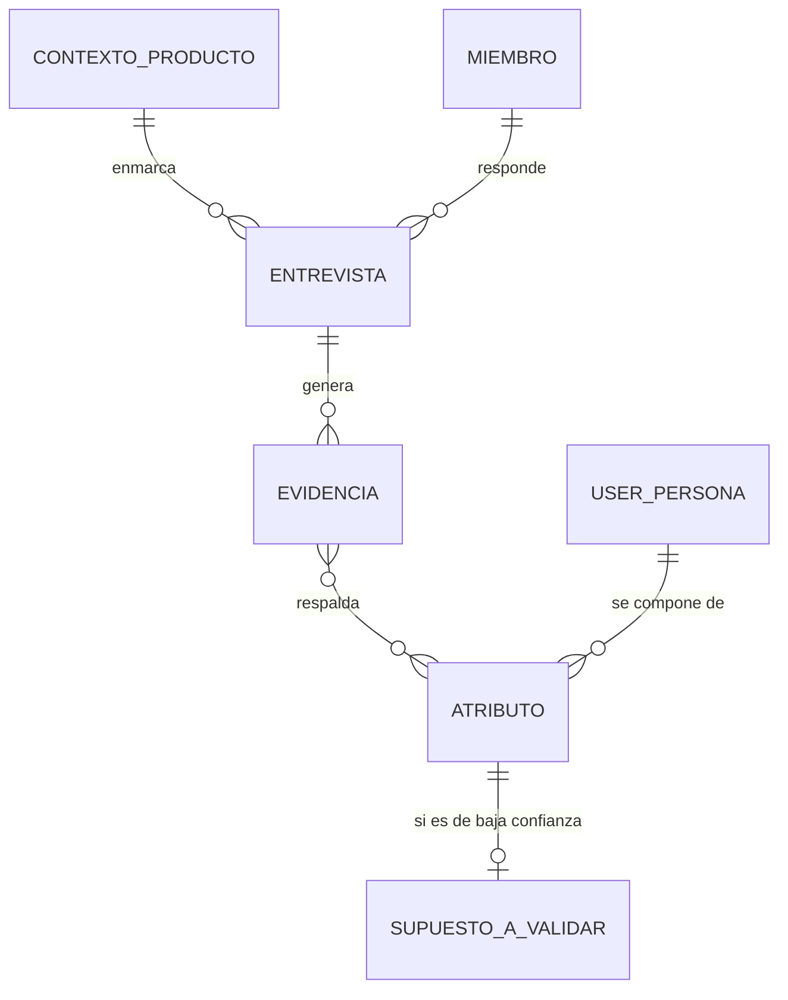
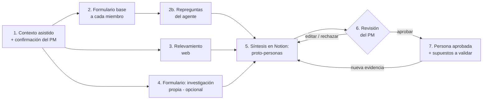

# Fase 2: Visión del producto

## Objetivo del proyecto

Proyecto de **aprendizaje y portfolio**. Busca demostrar Spec Driven Development y el diseño de agentes de IA con un **MVP funcional y bien documentado**, pensado para un **público limitado**. No hace falta escala, multi-tenant ni monetización.

## Forma de la solución: Notion + agente de IA

En lugar de construir una aplicación propia, la solución usa **Notion como interfaz y como base de conocimiento**, y un **agente de IA** que lee y escribe en Notion.

| Necesidad | Se resuelve con |
|-----------|-----------------|
| Cargar el contexto del producto | **El agente lo extrae** de fuentes que indica el PM (documento o URL), y el PM lo confirma. Hay un formulario como alternativa (ajustado en la Fase 3). |
| Cargar la investigación propia | **Formularios de Notion** |
| Entrevistar a cada miembro del equipo | Formulario base de Notion + **repreguntas del agente** en la página de cada miembro |
| Guardar fuentes y evidencia | **Base de datos** de Notion |
| Detallar las User Personas con trazabilidad | **Bases de datos relacionadas**: cada atributo se vincula a su evidencia |
| Revisar y aprobar | **Estado** de la persona, que solo cambia el PM, y comentarios de Notion |
| Versionar | Historial de páginas de Notion |

**Por qué Notion:**
- El público es limitado. No hace falta construir login, invitaciones, pantallas ni permisos: Notion ya los tiene.
- Todo queda en un solo lugar: la información, los formularios y las personas.
- El esfuerzo se concentra en lo que importa demostrar, que es **el agente y la spec**.

**Decisión sobre el agente:** un **agente propio**, con código y prompts propios, que lee y escribe en Notion mediante **MCP**. Notion también tiene agentes nativos y se podría hacer sin código, pero un agente propio da control sobre los prompts, la trazabilidad y las evaluaciones, y tiene más valor para un portfolio. El detalle de la conexión se define en la Fase 5.

**Modelo de lenguaje** (definido en la Fase 3): la **capa gratuita de Gemini** como proveedor principal y **OpenRouter** como secundario. El agente no depende de un proveedor en particular.

## Declaración de visión

> **Para** equipos de producto (PM, diseño e ingeniería) **que** necesitan saber para quién construyen, pero no tienen el tiempo ni la práctica para hacer research,
> **User-Persona Agente** es un **agente de IA que trabaja dentro de Notion**: recopila el conocimiento del equipo mediante formularios y repreguntas, releva información pública, suma la investigación propia y **detalla User Personas trazables a su evidencia**.
> **A diferencia de** los generadores de personas con IA, que inventan perfiles verosímiles en segundos, y de los workshops tradicionales, que formalizan supuestos, **nuestro producto** muestra de dónde sale cada atributo y qué tan confiable es, expone los desacuerdos del equipo, propone cómo validar los supuestos y **no da nada por válido sin la aprobación del Product Manager**.

**Visión a largo plazo:** que las personas sean el lenguaje común del equipo y estén conectadas a las decisiones del día a día. Por ejemplo, integrar Jira para vincular personas a épicas e historias.

## Usuarios y roles

| Rol | Qué hace |
|-----|----------|
| **Product Manager (owner)** | Duplica el espacio de Notion, indica las fuentes del contexto del producto y lo confirma, invita al equipo, ejecuta el agente, revisa, edita y **aprueba o rechaza** las personas. |
| **Miembro del equipo** (diseño, ingeniería, negocio) | Completa el formulario base y responde las repreguntas del agente en su página. |
| **Aportante de evidencia** (opcional; puede ser el PM) | Carga investigación propia mediante un formulario: entrevistas, encuestas, analítica o tickets de soporte. |

## Estructura en Notion (alto nivel)

| Base de datos | Contenido |
|---------------|-----------|
| **Contexto del producto** | Propuesta de valor, mercado, competidores y modelo de negocio, cada uno con su fuente. Lo arma el agente a partir de las fuentes que indica el PM, y el PM lo confirma. |
| **Equipo** | Miembros y roles. |
| **Entrevistas** | Respuestas al formulario base y repreguntas del agente, una página por miembro. |
| **Evidencia** | Cada fuente con su tipo (supuesto del equipo, información pública o investigación propia), su origen (miembro o URL) y un extracto. |
| **User Personas** | Una página por persona y versión, con estado (`Borrador → En revisión → Aprobada / Rechazada`, y `Reemplazada` para versiones anteriores), versión y aprobador. |
| **Atributos** | Afirmaciones de la persona por categoría (objetivos, problemas, comportamientos, contexto), con nivel de confianza, evidencias relacionadas y marca de divergencia. |
| **Supuestos a validar** | Plan de validación de cada atributo de baja confianza: método, preguntas sugeridas y estado. |

> El modelo de datos detallado se define en la Fase 5.

## Flujo principal

1. **Contexto del producto:** el PM indica las fuentes, el agente arma el contexto y el PM lo confirma. Si no hay nada escrito, se usa un formulario (ajustado en la Fase 3).
2. **Entrevista a cada miembro:** cada uno completa por separado un formulario base agnóstico de producto. Después, el agente analiza las respuestas y escribe **repreguntas** en la página de cada miembro para profundizar, aclarar o pedir ejemplos.
3. **Relevamiento web:** el agente busca competidores, reseñas, foros y estudios públicos, y registra cada fuente en la base de evidencia.
4. **Investigación propia** (opcional): se carga mediante un formulario.
5. **Síntesis:** el agente crea o actualiza las páginas de User Persona y sus atributos, cada uno vinculado a su evidencia, con nivel de confianza y marca de divergencia entre miembros.
6. **Revisión humana:** el PM edita, comenta, rechaza o aprueba. **El agente nunca puede marcar una persona como Aprobada.**
7. **Supuestos a validar:** para cada atributo de baja confianza, el agente propone cómo validarlo. Cuando entra evidencia nueva, el agente crea una versión nueva de la persona para revisar.

## Principios de producto

1. **Evidencia por sobre verosimilitud:** una persona incompleta y honesta vale más que una completa e inventada.
2. **La IA propone y el humano decide:** toda persona necesita la aprobación explícita del PM.
3. **Supuestos a la vista:** cada atributo muestra su fuente (investigación propia, información pública o supuesto del equipo) y su nivel de confianza.
4. **El desacuerdo es información:** las divergencias del equipo se muestran, no se promedian.
5. **Agnóstico de producto:** ni los formularios, ni las preguntas, ni las plantillas asumen una industria o un tipo de producto.
6. **Accionable, no decorativa:** la persona prioriza objetivos, problemas, comportamientos y contexto de uso por sobre datos de color ("le gusta el café").
7. **Artefacto vivo:** la persona tiene versiones y madura con la evidencia.
8. **Donde el equipo ya trabaja:** todo pasa en Notion, sin herramientas nuevas que adoptar.

## Qué es y qué no es

| ✅ Es | ❌ No es |
|-------|---------|
| Un agente de discovery que estructura y acelera la definición de personas dentro de Notion | Un generador de personas en un clic |
| Una herramienta que hace explícitos los supuestos y propone cómo validarlos | Un reemplazo de hablar con usuarios reales |
| Un espacio donde el equipo se alinea sobre quién es el usuario | Una herramienta de analítica ni un CRM |
| Un MVP de portfolio para un público limitado | Una aplicación web propia ni un SaaS |

## Alcance

| MVP | Futuro (fuera del MVP) |
|-----|------------------------|
| Plantilla de Notion con bases de datos y formularios | Integración con Jira: personas vinculadas a épicas e historias y marca de historias "como usuario…" sin persona |
| Contexto asistido desde un documento o una URL, con confirmación del PM | Ingesta automática (transcripciones, analítica, tickets) |
| Formulario base para cada miembro del equipo + repreguntas del agente | Ejecución automática del agente ante cada formulario nuevo |
| Relevamiento web con fuentes citadas | Alertas de personas desactualizadas |
| Formulario de investigación propia | Uso por muchos equipos en paralelo |
| Síntesis de proto-personas con fuente, confianza y divergencias | |
| Revisión y aprobación por el PM mediante estados de Notion | |
| Supuestos a validar con métodos sugeridos | |

## Métricas de éxito del producto

Las métricas de impacto de la Fase 1, como la adopción de funcionalidades o el % de iniciativas con persona objetivo, se miden a largo plazo y quedan fuera del alcance de un MVP de portfolio. Para el MVP medimos la **calidad y la utilidad de la solución**:

| Métrica | Tipo | Objetivo MVP |
|---------|------|--------------|
| **Trazabilidad:** % de atributos de cada persona vinculados a al menos una evidencia | Guardrail | **100%** |
| **Aprobación indebida:** personas que el agente marca como Aprobada | Guardrail | **0** |
| **Aceptación:** % de personas propuestas que **el PM aprueba**, con o sin ediciones menores | Calidad | ≥ 70% |
| **Retrabajo:** % de atributos que el PM tiene que reescribir | Calidad | ≤ 30% |
| **Esfuerzo por miembro:** formulario base + repreguntas | Eficiencia | ≤ 30 min (pauta de diseño: ≤ 15 preguntas base y ≤ 5 repreguntas) |
| **Tiempo total:** desde el contexto cargado hasta la primera persona aprobada | Eficiencia | ≤ 1 día de calendario |
| **Accionabilidad:** % de supuestos de baja confianza con un plan de validación | Accionabilidad | 100% |
| **Alineación:** divergencias del equipo detectadas y mostradas | Alineación | Se detectan todas las divergencias planteadas a propósito en la prueba |

**Qué significa trazabilidad.** Un *atributo* es cada afirmación de la persona, por ejemplo "Concilia los pagos a mano en Excel una vez por semana". Para que cuente como trazable, tiene que estar vinculado al menos a una fila de la base de **Evidencia** que diga de dónde salió: la respuesta de un miembro del equipo, una fuente pública con su URL o una investigación propia. Si solo lo dijo el equipo, igual queda vinculado, pero como **supuesto del equipo** y con confianza baja. Lo que no puede existir es un atributo sin ninguna evidencia, porque eso sería algo que el agente inventó.

## Plan de prueba del MVP

**Producto de prueba: cobros-recurrentes.** Es una app para que un **emisor** (un particular, una sociedad de fomento o un profesional independiente, en Argentina) le cobre un monto recurrente a un **pagador**. El pago se pide por email o WhatsApp, sin login, y la conciliación del comprobante es manual. Es un buen caso de prueba por tres razones:

- Es un producto real, con una spec escrita pero **sin investigación con usuarios**: el caso general que plantea la Fase 1.
- Tiene dos actores muy distintos y, dentro del emisor, **segmentos que pueden tener necesidades diferentes**. Son candidatos naturales a varias personas.
- Su spec es la fuente del **contexto asistido**: se sube a Notion solo la spec, no el código del repositorio.

**Miembros del equipo: una persona con distintos sombreros.** Abel completa los formularios y responde las repreguntas varias veces, cada vez con un rol distinto, por ejemplo PM, diseño, ingeniería y negocio. Cada rol tiene su propio nivel de conocimiento del usuario y sus opiniones. En algunos puntos se plantean **divergencias a propósito** para verificar que el agente las detecte. Como responde una persona real, el esfuerzo por miembro **se mide en minutos**.

## Preguntas abiertas de la Fase 2

- [x] ~~**Objetivo del proyecto**~~: aprendizaje y portfolio, con un público limitado.
- [x] ~~**Forma**~~: Notion (formularios + bases de datos) con un agente de IA. Jira queda para el futuro.
- [x] ~~**Entrevistas**~~: a cada miembro del equipo por separado, con formulario base y repreguntas del agente.
- [x] ~~**Agente**~~: propio, conectado a Notion por MCP. Usa Gemini (capa gratuita) como modelo principal y OpenRouter como secundario.
- [x] ~~**Métricas**~~: aprobadas.
- [x] ~~**Producto de prueba**~~: **cobros-recurrentes**. Abel hace de los distintos miembros del equipo.
- [x] ~~**Base metodológica**~~: *Inspired*, de Marty Cagan.
