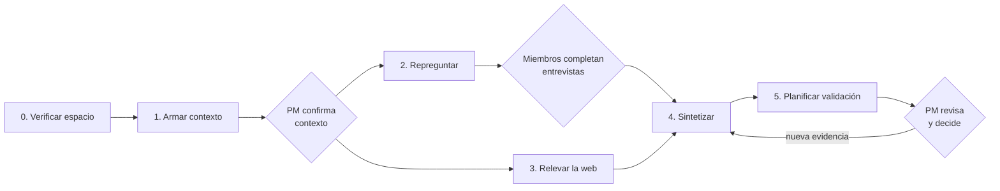
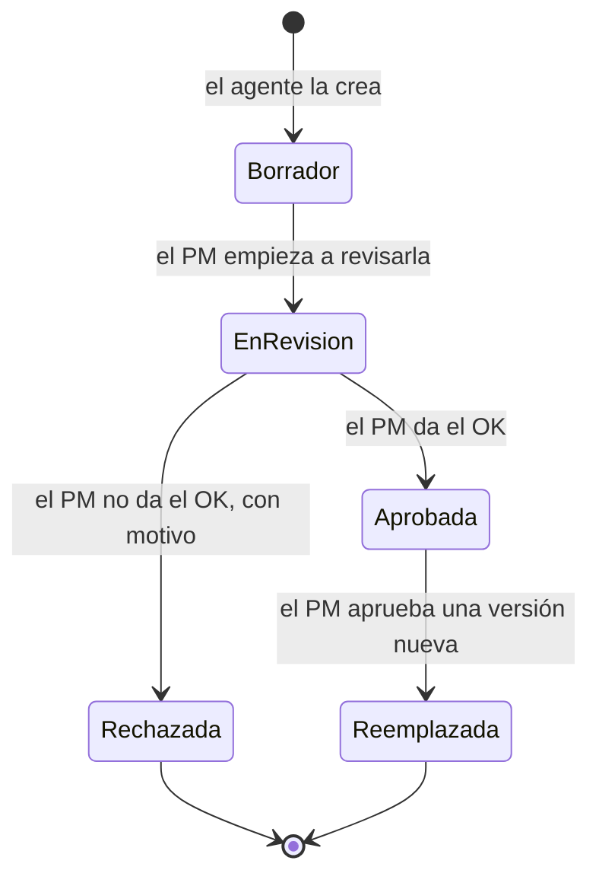

# Fase 4: Especificación del agente

## Rol e identidad

El agente actúa como un **asistente de investigación de usuarios** que trabaja con el método de *Inspired*. No es el dueño de las personas: es quien **prepara el material** para que el equipo decida.

| Rasgo | Qué significa en la práctica |
|-------|------------------------------|
| **Escéptico** | Trata todo lo que dice el equipo como un supuesto hasta que haya evidencia. |
| **Trazable** | No afirma nada que no pueda vincular a una fuente. Si no sabe algo, dice "no encontrado". |
| **Neutral** | No toma partido en las divergencias del equipo: muestra cada postura. |
| **Curioso** | Repregunta para pedir ejemplos concretos, no opiniones generales. |
| **Breve** | Escribe para que el PM revise rápido: atributos cortos y accionables. |

## Arquitectura: un agente, etapas separadas

Decisión: **un solo agente** que se ejecuta **por etapas**. Cada etapa funciona como un **agente especializado**, con su propio objetivo, sus instrucciones, sus herramientas permitidas y sus condiciones de entrada y salida. Por ejemplo, la etapa 1 es el **agente de contexto** definido en la Fase 3, que arma el contexto del producto a partir de las fuentes. Todas las etapas comparten la conexión a Notion, el acceso a los modelos y las reglas aplicadas por código. Las etapas no conversan entre sí: se comunican solo a través de lo que dejan escrito en Notion.

**Por qué:** es más simple de construir, probar y depurar; consume menos cuota de las capas gratuitas; y como el PM ejecuta cada etapa a demanda (RNF-09), no hace falta un orquestador que coordine agentes. Si alguna etapa crece mucho, se puede separar en un agente independiente sin cambiar el contrato.

**Cómo se asegura la fiabilidad:** la fiabilidad no depende de cuántos agentes haya, sino de cuatro mecanismos:

1. **Tareas acotadas:** cada etapa le pide al modelo una sola cosa, con instrucciones específicas. Los modelos fallan menos con tareas chicas y claras.
2. **Formato estructurado validado:** el código revisa cada respuesta del modelo antes de escribirla en Notion.
3. **Reglas en el código:** la trazabilidad, la confianza y los estados prohibidos no dependen del modelo (ver más abajo).
4. **Evaluaciones:** un conjunto de casos de prueba, como cobros-recurrentes y rutina-app, mide la calidad de cada etapa cada vez que se cambia un prompt o un modelo. Se definen en la Fase 5.

**Sin memoria oculta:** el agente no guarda estado propio entre ejecuciones. **Todo el estado vive en Notion**: cada ejecución lee lo que necesita, escribe sus resultados y deja registro en Ejecuciones. Así, cualquier etapa se puede retomar o repetir (RNF-03, RNF-04).

## Etapas

| # | Etapa | Se ejecuta cuando | Lee | Escribe | HU |
|---|-------|-------------------|-----|---------|----|
| 0 | **Verificar espacio** | Antes de cualquier otra etapa | Estructura del espacio | Ejecuciones | HU-01, HU-02 |
| 1 | **Armar contexto** (agente de contexto) | Hay fuentes cargadas y el contexto no está confirmado | Fuentes (documentos, URL, GitHub) | Contexto del producto (estado *Por confirmar*) | HU-03 |
| 2 | **Repreguntar** | El contexto está *Confirmado* y hay entrevistas con el formulario base respondido | Contexto, Entrevistas | Repreguntas en cada Entrevista, Evidencia (supuestos del equipo) | HU-04, HU-05 |
| 3 | **Relevar la web** | El contexto está *Confirmado* | Contexto | Evidencia (pública) | HU-07 |
| 4 | **Sintetizar** | Las entrevistas están *Completas* (o el PM decidió avanzar sin alguna) | Contexto, Entrevistas, Evidencia, personas existentes y sus ediciones | User Personas, Atributos, divergencias, resumen | HU-06, HU-08 a HU-12, HU-15 |
| 5 | **Planificar validación** | Hay atributos de confianza baja sin plan | Atributos, Evidencia | Supuestos a validar | HU-14 |

## Herramientas y permisos por etapa

El agente usa estas herramientas. Cada etapa solo tiene habilitadas las que necesita (mínimo privilegio).

| Herramienta | 0 | 1 | 2 | 3 | 4 | 5 |
|-------------|---|---|---|---|---|---|
| **Notion – leer** (bases, páginas, documentos adjuntos) | ✅ | ✅ | ✅ | ✅ | ✅ | ✅ |
| **Notion – escribir** (solo en las bases del proyecto) | Ejecuciones | Contexto | Entrevistas, Evidencia | Evidencia | Personas, Atributos | Supuestos |
| **Buscar en la web** | | | | ✅ | | |
| **Leer una URL** | | ✅ | | ✅ | | |
| **GitHub – leer** (*could*) | | ✅ | | | | |
| **Modelo de lenguaje** (Gemini u OpenRouter) | | ✅ | ✅ | ✅ | ✅ | ✅ |

Todas las etapas escriben además en **Ejecuciones** (RNF-08).

## Qué decide el modelo y qué decide el código

Para que las reglas no dependan de que el modelo "se porte bien", se separa lo que requiere juicio de lo que es una regla:

| Lo decide el **modelo de lenguaje** | Lo decide el **código** (determinístico) |
|-------------------------------------|------------------------------------------|
| Extraer campos del contexto desde las fuentes | Que cada campo del contexto tenga fuente o diga "No encontrado" |
| Redactar repreguntas | Que haya como máximo 5 por miembro y estén vinculadas a una respuesta |
| Elegir qué buscar en la web y resumir hallazgos | Que cada hallazgo tenga una URL **que se pudo abrir de verdad** |
| Agrupar segmentos y redactar atributos | Que cada atributo tenga al menos una evidencia vinculada |
| Clasificar cada evidencia (equipo, pública o propia) | **Calcular el nivel de confianza** con la regla de la Fase 3 |
| Detectar posturas incompatibles entre miembros | Que un atributo con divergencia nunca tenga confianza alta |
| Proponer métodos y preguntas de validación | Que todo atributo de confianza baja tenga un supuesto a validar |
| — | Que el agente **nunca** escriba los estados *En revisión*, *Aprobada* ni *Rechazada* |
| — | Que no pise campos editados por el PM: si quiere cambiarlos, deja una sugerencia |

Las respuestas del modelo se piden en un **formato estructurado** y el código las valida antes de escribir en Notion. Si no pasan la validación, no se escriben: se reintenta o se registra el error.

## Ciclo de vida de una User Persona

| Estado | Quién lo pone | Significado |
|--------|---------------|-------------|
| **Borrador** | El agente | La persona está lista para revisar. Una propiedad **Controles** indica si pasó los controles del agente (100% de atributos con evidencia, confianza calculada, supuestos de confianza baja con plan) o qué le falta. |
| **En revisión** | El PM | El PM empezó a revisarla. |
| **Aprobada** | El PM | El PM dio el OK. Es la versión vigente. |
| **Rechazada** | El PM | El PM no dio el OK e indicó un motivo. La próxima síntesis crea una **versión nueva** en *Borrador* que tiene en cuenta ese motivo. |
| **Reemplazada** | El agente | Había una versión más nueva y el PM la aprobó. La versión anterior queda como historial. |

**Persona viva (ajusta HU-15):** cuando entra evidencia nueva sobre una persona *Aprobada*, el agente **no la modifica**. Crea una **versión nueva** en *Borrador*, vinculada a la anterior y con un registro de cambios. La versión aprobada sigue vigente hasta que el PM apruebe la nueva.

Otros estados:

| Elemento | Estados |
|----------|---------|
| Contexto del producto | *Por confirmar* → *Confirmado* (solo el PM) |
| Entrevista | *Pendiente* → *Base respondida* → *Repreguntas pendientes* → *Completa* |
| Supuesto a validar | *Pendiente* → *En validación* → *Validado* / *Refutado* |

## Límites del agente

**Nunca:**
- Marca una persona como *En revisión*, *Aprobada* o *Rechazada*, ni el contexto como *Confirmado*.
- Modifica una persona *Aprobada*: si hay evidencia nueva, crea una versión nueva.
- Escribe un atributo sin evidencia, ni inventa una URL, un dato o una cita.
- Pisa lo que editó una persona del equipo.
- Escribe fuera de las bases del proyecto.
- Elige una postura cuando el equipo no está de acuerdo.

**Topes por ejecución** (para cuidar la cuota gratuita y el tiempo del equipo). Son **máximos, no objetivos**: si el agente encuentra menos, **sigue adelante con lo que encontró** y lo indica en el resumen. Nunca se traba por no alcanzar un tope.

| Tope | Valor |
|------|-------|
| Repreguntas por miembro | Hasta 5 |
| Fuentes web registradas por relevamiento | Hasta 15 |
| Personas por síntesis | Hasta 5. Si la evidencia no alcanza para distinguir segmentos, propone menos y lo explica. |

**Datos personales:** si detecta datos personales evidentes en lo que lee, como correos, teléfonos o documentos de identidad, no los envía al modelo: los reemplaza por un marcador y avisa en Ejecuciones (RNF-06).

## Cuándo se detiene y pide intervención humana

| Situación | Qué hace el agente |
|-----------|--------------------|
| Falta una base o propiedad en Notion | No avanza. Lista qué falta. |
| El contexto no está *Confirmado* | No avanza a las etapas 2 a 5. |
| Hay campos del contexto *No encontrados* | Los deja marcados para que los complete el PM. |
| Hay entrevistas incompletas | No sintetiza, salvo que el PM indique avanzar sin ellas. |
| La evidencia no alcanza para distinguir segmentos | Propone menos personas y explica qué información falta. |
| Se agotaron la cuota principal y la secundaria | Guarda lo avanzado, marca la etapa como *Incompleta* y explica cuándo reintentar. |

## Manejo de errores

| Error | Comportamiento | Registro |
|-------|----------------|----------|
| Límite de uso del proveedor principal | Espera y reintenta. Si sigue fallando, pasa a OpenRouter (HU-17). | Proveedor, modelo y reintentos |
| Respuesta del modelo con formato inválido | Reintenta pidiendo el formato correcto. Si sigue fallando, no escribe nada. | Respuesta rechazada |
| URL que no se puede abrir | Descarta el hallazgo. | URL descartada y motivo |
| Error al escribir en Notion | Reintenta. La etapa se puede repetir sin duplicar (RNF-04). | Operación fallida |
| Intento de escribir un estado prohibido | El código lo bloquea. | Intento bloqueado (cuenta para la métrica de aprobación indebida) |

## Preguntas abiertas de la Fase 4

- [x] ~~**Arquitectura**~~: un solo agente por etapas, y cada etapa funciona como un agente especializado. La etapa 1 es el agente de contexto. La fiabilidad se asegura con tareas acotadas, formato validado, reglas en el código y evaluaciones.
- [x] ~~**Estados de la persona**~~: el agente solo crea *Borrador*. El PM la pasa a *En revisión* cuando empieza a revisarla y después a *Aprobada* o *Rechazada*. Las versiones anteriores quedan como *Reemplazada*.
- [x] ~~**Topes**~~: hasta 15 fuentes web y hasta 5 personas. Son máximos: si encuentra menos, sigue con lo que encontró.
