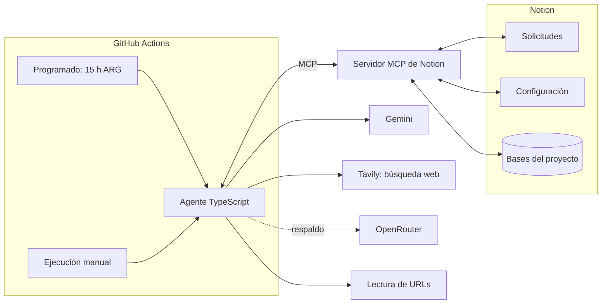
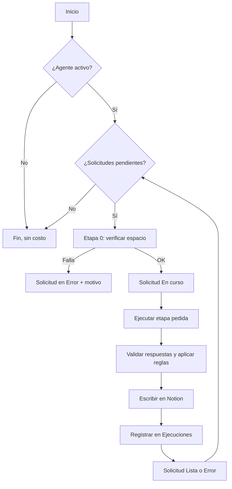

# Fase 5: Diseño técnico

## Arquitectura general

El PM trabaja **solo en Notion**. El agente corre en **GitHub Actions** una vez por día, atiende las solicitudes pendientes y escribe los resultados en Notion.



## Stack

| Pieza | Elección | Por qué |
|-------|----------|---------|
| Lenguaje | **TypeScript** sobre Node.js (versión LTS) | Es el lenguaje de los otros proyectos de Abel y tiene buenos SDK para MCP y los modelos. |
| Conexión con Notion | **Cliente MCP** (SDK oficial de MCP para TypeScript) conectado a un **servidor MCP de Notion** que corre dentro de la misma ejecución | Cumple la decisión de la Fase 2 (MCP). Se usa un servidor que funciona con un **token de integración**, porque en GitHub Actions no hay una persona que pueda iniciar sesión. El servidor exacto se confirma al implementar. |
| Modelo principal | **Gemini** (capa gratuita), modelo de la familia *Flash* | Rápido, con buena calidad para tareas acotadas. El modelo concreto es configuración (RNF-02). |
| Búsqueda web | **Tavily** (plan gratuito), separado del modelo. *Cambiado el 2026-10-26: la búsqueda integrada de Gemini no tiene capa gratuita en los modelos 3.x (ver [Fase 7, H6](07-implementacion.md#h6-etapa-3-relevamiento-web)).* | Devuelve las fuentes con su URL. Cada URL se verifica abriéndola antes de guardarla. |
| Modelo de respaldo | **OpenRouter**, con un modelo gratuito | Usa una API compatible con OpenAI, así que el adaptador es simple. |
| Validación | **Zod** | Define los formatos de respuesta del modelo y los valida antes de escribir. |
| Pruebas | **Vitest** | Pruebas unitarias de las reglas en código. |
| Ejecución | **GitHub Actions** | Programado y manual, con las claves guardadas como secretos. |

## Ejecución desde Notion

**Base Solicitudes.** El PM crea una fila, elige la etapa y la deja en *Pendiente*.

| Propiedad | Tipo | Valores |
|-----------|------|---------|
| Etapa | Selección | Armar contexto, Repreguntar, Relevar la web, Sintetizar, Planificar validación |
| Estado | Estado | *Pendiente* → *En curso* → *Lista* / *Error* |
| Opciones | Texto | Por ejemplo, "avanzar sin las entrevistas incompletas" (HU-06) |
| Pedido por | Persona | Quién la pidió |
| Ejecución | Relación | Fila de Ejecuciones con el detalle |

**Página Configuración.** Desde Notion se controla el agente:

| Propiedad | Para qué |
|-----------|----------|
| **Agente activo** (sí/no) | **Pausa el agente** sin tocar GitHub. Si está apagado, la ejecución termina sin hacer nada. |
| Modelo principal / de respaldo | Cambiar de modelo sin tocar código |
| Idioma | Se completa al confirmar el contexto (RNF-05) |

**Programación.** El workflow corre **todos los días a las 15:00 de Argentina** (18:00 UTC, `cron: "0 18 * * *"`). También se puede ejecutar a mano desde GitHub para pruebas. Del 2026-11-10 al 2026-11-12 el programado estuvo apagado, para cuidar la cuota durante las evaluaciones del H9 (ver la [Fase 7](07-implementacion.md#h9-evaluaciones-y-prueba-de-aceptación)).

**Cómo se evita gastar de más:**
1. Si en Configuración el agente está **pausado**, termina sin hacer nada.
2. Si **no hay solicitudes pendientes**, termina **sin llamar al modelo**: no gasta ni un token.
3. Los topes de la Fase 4 limitan cuánto hace cada etapa.
4. El programado también se puede **desactivar desde GitHub** (pestaña Actions → *Disable workflow*).

### Cómo pausar y reanudar el agente (paso a paso)

**Opción 1: desde Notion** (recomendada, no requiere conocimientos técnicos)

Para **pausar**:
1. Abrí el espacio del proyecto en Notion.
2. Entrá a la página **Configuración**.
3. **Desmarcá** la casilla **Agente activo**.
4. Listo. En la próxima ejecución programada (15 h), el agente lee la casilla, ve que está apagada y termina **sin hacer nada y sin gastar tokens**. Deja una fila en Ejecuciones con el resultado *Pausado*.

Para **reanudar**:
1. Volvé a **marcar** la casilla **Agente activo**.
2. Las solicitudes que se crearon durante la pausa quedaron en *Pendiente*, así que se atienden en la próxima ejecución.

**Opción 2: desde GitHub** (corta también la ejecución programada, así que no usa ni minutos de GitHub Actions)

Para **desactivar**:
1. Entrá a [github.com/abellatuf/User-Persona-Agente](https://github.com/abellatuf/User-Persona-Agente).
2. Abrí la pestaña **Actions**.
3. En la lista de la izquierda, elegí el workflow **Agente** (`agente.yml`).
4. Hacé clic en el botón **⋯** (arriba a la derecha) y después en **Disable workflow**.

Para **reactivar**: en el mismo lugar, hacé clic en **Enable workflow**.

> Usá la opción 1 para pausas habituales. La opción 2 conviene si el proyecto va a quedar quieto mucho tiempo.

> GitHub puede demorar unos minutos las ejecuciones programadas en horarios de mucha demanda. Además, **desactiva automáticamente** los workflows programados de un repo sin actividad durante 60 días. Hay que tenerlo en cuenta si el proyecto queda quieto.

## Flujo de una ejecución



## Estructura del repositorio

```text
User-Persona-Agente/
├── README.md                  ← índice y bitácora
├── docs/                      ← una fase por archivo
├── agent/
│   ├── src/
│   │   ├── main.ts            ← punto de entrada: lee Configuración y Solicitudes
│   │   ├── stages/            ← una carpeta por etapa (0 a 5)
│   │   ├── prompts/           ← instrucciones de cada etapa, en archivos de texto
│   │   ├── llm/               ← interfaz común + adaptadores de Gemini y OpenRouter + respaldo
│   │   ├── notion/            ← cliente MCP y acceso a cada base
│   │   ├── guards/            ← reglas en código: trazabilidad, confianza, estados, datos personales, ediciones del PM
│   │   └── schemas/           ← formatos de respuesta (Zod)
│   └── test/                  ← pruebas unitarias de las reglas
├── evals/
│   ├── casos/                 ← cobros-recurrentes y rutina-app
│   └── run.ts                 ← ejecuta las evaluaciones y genera un reporte
└── .github/workflows/
    ├── agente.yml             ← programado (15 h ARG) + manual
    └── evals.yml              ← solo manual, para cuidar la cuota
```

## Modelo de datos en Notion

Detalle de las bases definidas en la Fase 2, más Solicitudes y Configuración.

| Base | Propiedades principales |
|------|-------------------------|
| **Contexto del producto** | Nombre, Problema, Propuesta de valor, Usuarios que creemos tener, Mercado, Modelo de negocio, Competidores (cada campo con su **fuente** o "No encontrado"), Fuentes (relación con los documentos o URL), Estado (*Por confirmar* / *Confirmado*), Idioma |
| **Equipo** | Nombre, Rol (PM, diseño, ingeniería, negocio, otro), Persona de Notion |
| **Entrevistas** | Miembro (relación), Respuestas del formulario base, Repreguntas (bloques en la página), Estado (*Pendiente* → *Base respondida* → *Repreguntas pendientes* → *Completa*) |
| **Evidencia** | Extracto, Tipo (*Supuesto del equipo* / *Pública* / *Investigación propia*), Origen (relación con Entrevista, o URL), Título, Fecha de consulta, Etapa que la creó |
| **User Personas** | Nombre, Resumen, Por qué es un segmento distinto, Estado (*Borrador* / *En revisión* / *Aprobada* / *Rechazada* / *Reemplazada*), Versión, Versión anterior (relación), Registro de cambios, Controles, Motivo de rechazo, Aprobada por |
| **Atributos** | Afirmación, Categoría (*Objetivo* / *Problema* / *Comportamiento* / *Contexto*), Persona (relación), Evidencias (relación), Confianza (*Alta* / *Media* / *Baja*, calculada por código), Divergencia (sí/no + posturas), Sugerencia del agente |
| **Supuestos a validar** | Atributo (relación), Método, Perfil a contactar, Preguntas sugeridas, Estado (*Pendiente* → *En validación* → *Validado* / *Refutado*) |
| **Ejecuciones** | Etapa, Solicitud (relación), Inicio y fin, Proveedor y modelo, Lecturas y escrituras, Resultado, Errores, Intentos bloqueados |
| **Solicitudes** | Ver la sección *Ejecución desde Notion* |

## Reglas en código

**Cálculo de confianza** (regla de la Fase 3):

```text
si el atributo tiene divergencia sin resolver:
    confianza = máximo Media
si tiene ≥ 2 evidencias de investigación propia de fuentes distintas:
    confianza = Alta
si tiene 1 de investigación propia, o una pública que coincide con un supuesto del equipo:
    confianza = Media
en otro caso:
    confianza = Baja
```

**Otras reglas:**

| Regla | Cómo se implementa |
|-------|--------------------|
| Trazabilidad | No se escribe ningún atributo con la relación Evidencias vacía. |
| Estados prohibidos | Todas las escrituras pasan por una función que rechaza *En revisión*, *Aprobada* y *Rechazada* en personas, y *Confirmado* en el contexto. |
| No pisar al PM | Antes de actualizar, se mira quién editó por última vez. Si no fue la integración del agente, o si la casilla *Editado por el PM* está marcada, no se modifica: se escribe en *Sugerencia del agente* y se marca la casilla (ajustado en el H2). |
| URLs reales | Antes de guardar una evidencia pública, se abre la URL. Si no responde, se descarta. |
| Datos personales | Antes de enviar texto al modelo, se reemplazan correos, teléfonos y números de documento por marcadores. |
| Idempotencia | Cada elemento tiene una clave estable (por ejemplo, persona + afirmación normalizada), guardada en la propiedad *Clave*, así que repetir una etapa actualiza en lugar de duplicar. |

## Prompts

Cada etapa tiene su archivo de instrucciones con la misma estructura:

1. **Rol y reglas comunes:** asistente de investigación, escéptico, trazable y neutral. Nunca inventa, y si no sabe algo dice "no encontrado".
2. **Tarea de la etapa:** una sola tarea, con criterios concretos.
3. **Datos:** el contenido de Notion, las fuentes y la web, **delimitado y marcado como datos**. Cualquier instrucción que aparezca dentro de una fuente se ignora: un documento o una página web no pueden darle órdenes al agente.
4. **Formato de salida:** un JSON que valida Zod.
5. **Idioma:** el idioma del contexto confirmado.

Los prompts no mencionan ninguna industria ni producto (RNF-12). Lo específico del producto entra solo como dato.

## Evaluaciones

Las evaluaciones verifican que el agente siga funcionando bien cuando se cambia un prompt o un modelo. Se ejecutan **a mano** con `evals.yml`, para no gastar cuota en cada cambio.

| Tipo | Qué verifica | Cómo |
|------|--------------|------|
| **Reglas** (sin modelo) | Confianza, estados prohibidos, trazabilidad, datos personales, idempotencia | Pruebas unitarias con Vitest, en cada cambio de código |
| **Formato** | Que todas las respuestas del modelo cumplan su esquema | Automática, en cada evaluación |
| **Trazabilidad** | 100% de atributos con evidencia y URLs que se pueden abrir | Automática |
| **Divergencias** | Que se detecten las divergencias planteadas a propósito en los casos de prueba | Automática: cada caso trae una lista de divergencias esperadas |
| **Topes** | Hasta 5 repreguntas, 15 fuentes y 5 personas | Automática |
| **Agnóstico** | Que no aparezcan términos de un producto en el resultado del otro | Automática, comparando cobros-recurrentes con rutina-app |
| **Calidad** | Aceptación y retrabajo (métricas de la Fase 2) | Revisión humana del PM en Notion |

Cada caso de prueba guarda en `evals/casos/` las entradas (spec del producto y respuestas de los sombreros) y lo que se espera (divergencias sembradas, segmentos esperables).

## Seguridad

- **Claves:** `NOTION_TOKEN`, `GEMINI_API_KEY`, `OPENROUTER_API_KEY` y, desde el H6, `TAVILY_API_KEY` se guardan como **secretos de GitHub Actions**. Nunca se suben al repositorio.
- **Notion:** la integración se comparte **solo con la página del proyecto** (RNF-10).
- **Inyección de instrucciones:** el contenido de documentos y páginas web es **dato, no instrucción**. Además, cada etapa tiene herramientas limitadas y el código bloquea las escrituras prohibidas, así que aunque una fuente intente manipular al modelo, el daño posible es acotado.
- **Repositorio:** queda **privado**. No hace falta que sea público para desarrollar ni para ejecutar el agente. Si en el futuro se hace público para el portfolio, las ejecuciones desde *forks* no reciben los secretos, así que nadie de afuera puede usar las claves.
- **Permisos para la implementación:** para que el asistente pueda subir los archivos de `.github/workflows/`, el token del conector de GitHub necesita además el permiso **Workflows: Read and write**. Los secretos los carga Abel a mano en **Settings → Secrets and variables → Actions**.

## Preguntas abiertas de la Fase 5

- [x] ~~**Lenguaje**~~: TypeScript.
- [x] ~~**Ejecución**~~: panel de Solicitudes en Notion + GitHub Actions programado una vez por día, a las 15 h de Argentina, con pausa desde Notion.
- [x] ~~**Búsqueda web**~~: búsqueda integrada de Gemini. Reemplazada por Tavily el 2026-10-26 (decisión C revisada del H6).
- [x] ~~**Repositorio**~~: el código va en este mismo repo, que **queda privado**.
- [x] ~~**Pausa**~~: desde la casilla *Agente activo* de la página Configuración de Notion, o desactivando el workflow en GitHub. El paso a paso está más arriba.
