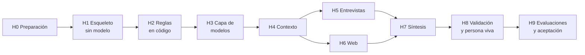

# Fase 6: Plan de tareas

## Cómo está armado el plan

- **Hitos verticales:** cada hito deja algo **funcionando de punta a punta** que se puede probar en Notion. No se construye todo el código primero y se prueba al final.
- **Tareas chicas:** cada tarea tiene un **criterio de terminado verificable** y referencia las HU y RNF que cubre.
- **Cierre de cada hito:** se hace una demo corta y **Abel aprueba** antes de pasar al siguiente, igual que con las fases.
- **Responsables:** 👤 **Abel** hace lo que requiere sus cuentas o sus decisiones (claves, secretos, permisos, revisión). 🤖 **El asistente** escribe el código, los prompts, las pruebas y la plantilla de Notion.
- **El modelo de lenguaje entra tarde, a propósito:** primero se construyen el circuito con Notion y las reglas en código, que no gastan cuota. Así, cuando entra el modelo, las protecciones ya existen.

## H0. Preparación de cuentas y accesos

| ID | Tarea | Quién | Terminado cuando… | Cubre |
|----|-------|-------|-------------------|-------|
| T0.1 | Crear la **integración interna de Notion** y guardar su token | 👤 | Existe la integración y el token está guardado en un lugar seguro | RNF-10 |
| T0.2 | Crear la **página raíz del proyecto** en Notion y compartirla **solo** con la integración | 👤 | La integración ve esa página y nada más | HU-02, RNF-10 |
| T0.3 | Obtener la **clave de Gemini** (capa gratuita) y la **clave de OpenRouter** | 👤 | Las dos claves funcionan en una prueba manual | RNF-01 |
| T0.4 | Cargar los **secretos** en GitHub (`NOTION_TOKEN`, `GEMINI_API_KEY`, `OPENROUTER_API_KEY`) | 👤 | Aparecen en *Settings → Secrets and variables → Actions* | Seguridad |
| T0.5 | Definir el **método de trabajo** para escribir y probar el código (ver preguntas abiertas) | 👤 🤖 | El asistente puede escribir, correr las pruebas y subir cambios | — |

## H1. Esqueleto de punta a punta, sin modelo de lenguaje

**Demo:** Abel crea una Solicitud en Notion, ejecuta el workflow a mano y ve cómo la solicitud pasa a *Lista* con su fila en Ejecuciones. No se gasta ni un token.

| ID | Tarea | Quién | Terminado cuando… | Cubre |
|----|-------|-------|-------------------|-------|
| T1.1 | Inicializar el proyecto TypeScript en `agent/` (Node LTS, Zod, Vitest, lint) | 🤖 | `npm test` corre en verde con una prueba de ejemplo | — |
| T1.2 | Crear la **plantilla de Notion**: las 9 bases con sus propiedades y relaciones, la página Configuración y los formularios | 🤖 + 👤 aprueba | La estructura coincide con el modelo de datos de la Fase 5 | HU-01 |
| T1.3 | **Cliente MCP** hacia el servidor MCP de Notion (elegir y fijar el servidor) | 🤖 | El agente lee y escribe una página de prueba usando el token | HU-02 |
| T1.4 | **Etapa 0: verificar espacio** (bases y propiedades obligatorias) | 🤖 | Si falta algo, la solicitud queda en *Error* con la lista de lo que falta | HU-01 |
| T1.5 | **Bucle de solicitudes**: leer Configuración, salir si está pausado o no hay pendientes, y marcar *En curso* → *Lista* / *Error* | 🤖 | Con el agente pausado o sin solicitudes, termina sin hacer nada | RNF-09 |
| T1.6 | **Registro en Ejecuciones** (inicio, fin, resultado, errores) | 🤖 | Cada ejecución deja su fila | HU-16, RNF-08 |
| T1.7 | **Workflow `agente.yml`**: programado a las 18:00 UTC y ejecución manual | 🤖 | La ejecución manual funciona desde la pestaña Actions | RNF-09 |

## H2. Reglas en código (sin modelo)

**Demo:** las pruebas unitarias muestran que las reglas se cumplen, incluido el bloqueo de estados prohibidos.

| ID | Tarea | Quién | Terminado cuando… | Cubre |
|----|-------|-------|-------------------|-------|
| T2.1 | **Cálculo de confianza** según la regla de la Fase 3 | 🤖 | Pruebas para Alta, Media, Baja y el tope por divergencia | HU-09 |
| T2.2 | **Guardia de estados prohibidos** en todas las escrituras | 🤖 | Una prueba intenta escribir *Aprobada* y queda bloqueada y registrada | HU-13, RNF-07 |
| T2.3 | **Guardia de trazabilidad**: ningún atributo sin evidencia | 🤖 | Una prueba con un atributo sin evidencia falla la escritura | HU-09 |
| T2.4 | **No pisar al PM**: detectar ediciones humanas y escribir en *Sugerencia del agente* | 🤖 | Una prueba con una edición del PM no la sobrescribe | HU-12 |
| T2.5 | **Ocultar datos personales** (correos, teléfonos, documentos) | 🤖 | Una prueba con datos de ejemplo los reemplaza por marcadores | RNF-06 |
| T2.6 | **Idempotencia**: claves estables para crear o actualizar | 🤖 | Ejecutar dos veces lo mismo no duplica filas | RNF-04 |

## H3. Capa de modelos

**Demo:** una llamada de prueba devuelve una respuesta validada. Si se fuerza un error en Gemini, responde OpenRouter y queda registrado.

| ID | Tarea | Quién | Terminado cuando… | Cubre |
|----|-------|-------|-------------------|-------|
| T3.1 | **Interfaz común** de modelos + adaptador de **Gemini** con salida estructurada | 🤖 | Una respuesta de prueba pasa la validación de Zod | RNF-02 |
| T3.2 | Adaptador de **OpenRouter** | 🤖 | La misma prueba funciona con OpenRouter | RNF-02 |
| T3.3 | **Reintentos y respaldo** ante límites de uso | 🤖 | Con un error simulado, reintenta, pasa al respaldo y lo registra | HU-17, RNF-03 |
| T3.4 | **Reintento por formato inválido** | 🤖 | Una respuesta inválida simulada se reintenta y, si sigue mal, no se escribe nada | Fase 4 |
| T3.5 | **Plantilla base de prompts** (rol, reglas comunes, datos delimitados, idioma) | 🤖 | Todas las etapas la reutilizan | RNF-05, RNF-12 |

## H4. Etapa 1: agente de contexto

**Demo:** Abel sube la spec de cobros-recurrentes, pide *Armar contexto* y encuentra el contexto en *Por confirmar*, con la fuente de cada campo.

| ID | Tarea | Quién | Terminado cuando… | Cubre |
|----|-------|-------|-------------------|-------|
| T4.1 | Leer **documentos adjuntos** en Notion | 🤖 | Lee el texto de un `.md` o `.pdf` subido | HU-03 |
| T4.2 | Leer una **URL pública** | 🤖 | Extrae el texto de una página de prueba | HU-03 |
| T4.3 | **Prompt y esquema** del contexto, con fuente por campo o "No encontrado" | 🤖 | Ningún campo queda sin fuente o sin la marca | HU-03 |
| T4.4 | Escribir el contexto en estado ***Por confirmar*** y **bloquear** las etapas siguientes hasta que el PM lo confirme | 🤖 | Pedir *Repreguntar* sin contexto confirmado da *Error* con el motivo | HU-03 |
| T4.5 | **Formulario de contexto manual** | 🤖 | Lo cargado a mano queda igual que el contexto asistido | HU-03b |
| T4.6 | Lectura desde **GitHub** (*could*) | 🤖 | Opcional, al final del MVP | HU-03 |
| T4.7 | **Revisión de Abel** con cobros-recurrentes | 👤 | Abel confirma el contexto y anota qué tuvo que corregir | Métricas |

## H5. Etapa 2: entrevistas y repreguntas

**Demo:** Abel completa el formulario con 3 sombreros, pide *Repreguntar* y encuentra hasta 5 repreguntas en cada página.

| ID | Tarea | Quién | Terminado cuando… | Cubre |
|----|-------|-------|-------------------|-------|
| T5.1 | **Formulario base** agnóstico (hasta 15 preguntas) | 🤖 + 👤 aprueba | Abel aprueba las preguntas | HU-04 |
| T5.2 | Convertir respuestas en **evidencia** del tipo *supuesto del equipo* | 🤖 | Cada respuesta tiene su evidencia vinculada al miembro y su rol | HU-04 |
| T5.3 | **Prompt de repreguntas** (abiertas, sin sesgo, vinculadas a una respuesta) | 🤖 | Hasta 5 por miembro, cada una con su respuesta de origen | HU-05 |
| T5.4 | **Estados de la entrevista** y opción *avanzar sin las incompletas* | 🤖 | Se respetan los estados, y la opción queda registrada | HU-06 |
| T5.5 | **Prueba con sombreros** | 👤 | Abel responde como PM, ingeniería y negocio, con al menos 2 divergencias planteadas, y mide su tiempo | Métricas |

## H6. Etapa 3: relevamiento web

**Demo:** al pedir *Relevar la web*, aparecen hasta 15 evidencias públicas, todas con una URL que se puede abrir.

| ID | Tarea | Quién | Terminado cuando… | Cubre |
|----|-------|-------|-------------------|-------|
| T6.1 | Búsqueda con **Gemini + Google Search** | 🤖 | Devuelve hallazgos con URL | HU-07 |
| T6.2 | **Verificar cada URL** antes de guardarla | 🤖 | Las URL que no responden se descartan y se registran | RNF-11 |
| T6.3 | Guardar la evidencia **pública** con título, fecha y extracto | 🤖 | Hasta 15 fuentes; si hay menos, sigue igual | HU-07 |
| T6.4 | Manejar la **cuota agotada** | 🤖 | La etapa queda *Incompleta* y no falla el resto | HU-07 |

## H7. Etapa 4: síntesis de personas

**Demo:** al pedir *Sintetizar*, aparecen proto-personas en *Borrador* con atributos trazables, confianza calculada, divergencias y resumen.

| ID | Tarea | Quién | Terminado cuando… | Cubre |
|----|-------|-------|-------------------|-------|
| T7.1 | **Prompt y esquema** de segmentos y personas (hasta 5) | 🤖 | Cada persona explica por qué es un segmento distinto | HU-09 |
| T7.2 | Crear **atributos** vinculados a la evidencia, con la confianza calculada por código | 🤖 | 100% de atributos con evidencia | HU-09 |
| T7.3 | **Detección de divergencias** con las posturas y sus autores | 🤖 | Se detectan las divergencias planteadas en H5 | HU-10 |
| T7.4 | **Resumen** y propiedad **Controles** | 🤖 | El PM ve qué pasó los controles y qué falta | HU-11 |
| T7.5 | Usar la **investigación propia** del formulario | 🤖 | Una evidencia propia sube la confianza según la regla | HU-08 |
| T7.6 | Tener en cuenta el **motivo de rechazo** en la próxima versión | 🤖 | Una persona rechazada genera una versión nueva que responde al motivo | HU-13 |

## H8. Etapa 5: validación y persona viva

**Demo:** cada atributo de confianza baja tiene su supuesto a validar. Al cargar evidencia nueva sobre una persona aprobada, aparece una versión nueva en *Borrador*.

| ID | Tarea | Quién | Terminado cuando… | Cubre |
|----|-------|-------|-------------------|-------|
| T8.1 | **Prompt de plan de validación** (método, perfil, preguntas) | 🤖 | 100% de atributos de confianza baja con su plan | HU-14 |
| T8.2 | **Versionado**: versión nueva en *Borrador*, registro de cambios y *Reemplazada* al aprobarse la nueva | 🤖 | La versión aprobada no se modifica nunca | HU-15 |

## H9. Evaluaciones y prueba de aceptación

**Demo:** el reporte de evaluaciones con los dos casos, y las métricas de la Fase 2 medidas en la prueba de aceptación.

| ID | Tarea | Quién | Terminado cuando… | Cubre |
|----|-------|-------|-------------------|-------|
| T9.1 | **Caso cobros-recurrentes** en `evals/casos/` (spec, respuestas de los sombreros y divergencias esperadas) | 🤖 + 👤 | El caso está completo | Evaluaciones |
| T9.2 | **Runner de evaluaciones** y workflow `evals.yml` (solo manual) | 🤖 | Genera un reporte con todos los chequeos de la Fase 5 | Evaluaciones |
| T9.3 | **Prueba de aceptación** con cobros-recurrentes | 👤 | Se miden todas las métricas de la Fase 2 | Fase 3 |
| T9.4 | **Caso rutina-app** (*should*) | 🤖 + 👤 | Pasa el chequeo de agnóstico de producto | RNF-12 |
| T9.5 | **Documentar resultados** en el README | 🤖 | La sección de resultados queda publicada | Portfolio |

## Definición de terminado del MVP

El MVP está terminado cuando:

- [ ] Las HU *must* están implementadas y cada una pasó su criterio de aceptación.
- [ ] Las pruebas unitarias de las reglas están en verde.
- [ ] La prueba de aceptación con cobros-recurrentes cumple los objetivos de la Fase 2: 100% de trazabilidad, 0 aprobaciones indebidas, todas las divergencias detectadas, 100% de supuestos de confianza baja con plan y 30 minutos o menos por sombrero.
- [ ] Abel puede usar todo **solo desde Notion**.
- [ ] El README documenta los resultados.

## Preguntas abiertas de la Fase 6

- [x] ~~**Método de trabajo para la implementación (T0.5)**~~: confirmado. Abel no puede trabajar en su máquina por ahora, así que el asistente escribe y prueba el código en la carpeta de su sesión de Claude Code, que ya tiene Node.js, y lo sube a GitHub con el conector. Abel no instala nada, y un workflow de CI corre las pruebas en GitHub Actions en cada cambio, como segunda red.
- [x] ~~**Plantilla de Notion (T1.2)**~~: la crea el asistente con el MCP de Notion.
- [x] ~~**Orden de los hitos**~~: aprobado, con una demo y la aprobación de Abel al cierre de cada uno.
- [x] ~~**README**~~: cada fase pasa a su archivo en `docs/`, y el README queda con el índice y la bitácora.
